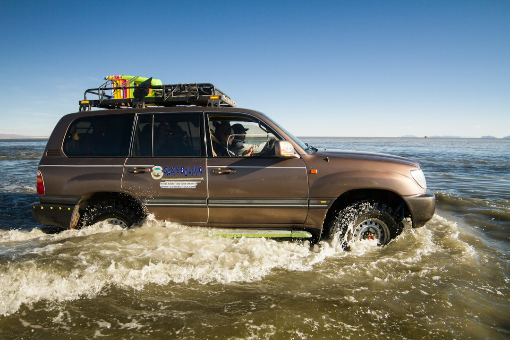

*This post contains affiliate links. As an Amazon Associate, I earn from qualifying purchases at no extra cost to you.*

A snorkel will not make your truck amphibious. What it does is move the most vulnerable opening on your engine from a spot low behind the headlight to roof height. A DIY install costs a fraction of what a shop charges, and it is one of the few overlanding mods that protects against two different problems at once: water ingestion and fine dust.

My position is simple. If you cross moving water or drive dusty washboard roads regularly, a snorkel is a better use of money than most cosmetic upgrades. If you stick to paved campgrounds and gravel forest roads, skip it and spend the money on tires and recovery gear. A snorkel also does nothing for the rest of your drivetrain, and it introduces a new failure point if you install it carelessly. The cut in your fender and the seal at the airbox are what separate a snorkel that protects your engine from one that quietly feeds it dust.

This guide covers what a snorkel does and does not do, how to check fitment and plan your budget, a step-by-step install, and the mistakes that cause the most trouble.

Photo by <a href="https://unsplash.com/@andreahuls?utm_source=artlines_blog&utm_medium=referral">Andrea Huls Pareja</a> on <a href="https://unsplash.com/?utm_source=artlines_blog&utm_medium=referral">Unsplash</a>

## What a Snorkel Actually Does for Water Crossings and Dust

Most trucks and SUVs draw intake air from a low point in the front fender or behind a headlight, close to the height of your bumper. That placement is fine on pavement. In a deep puddle or river crossing, the intake sits close to the waterline. Water pulled into an engine cannot be compressed, and the result is hydrolock, which can bend connecting rods or crack components. Repairs can cost more than the vehicle is worth.

A snorkel relocates the air inlet to roughly the height of your roofline, usually along the A-pillar. That buys you extra depth before the intake itself goes under, and it is the main reason people install one for water work.

### The dust benefit is just as real

Air near the ground on a dirt road is much dustier than air a few feet higher, especially when you follow another vehicle. A snorkel head mounted high pulls from cleaner air. Many designs also use a ram-style opening that faces forward, which helps keep dust and rain from being sucked straight in. Cleaner air means your filter loads more slowly and your intervals stretch out.

Our guide on [protecting your engine from dust and debris on remote trails](/2026/09/26/protecting-your-engine-from-dust-and-debris-on-remote-trails/) covers the filter side of this in more detail.

### What a snorkel does not do

This is where owners get into trouble. A snorkel protects the engine's air path only. It does not protect your differentials, transmission, transfer case, alternator, starter, or electrical connectors, and it does not seal the exhaust. Axle and transmission breathers are separate vents that can pull in water when hot components hit cold water. Treat any crossing deeper than your manufacturer's stated wading depth as a risk, snorkel or not. Check your owner's manual for that figure, and read our [water crossings technique and vehicle prep guide](/2026/05/23/2026-05-23-water-crossings-technique-and-vehicle-prep/) before you rely on new hardware in real water.

A snorkel is also not a license to drive fast through water. Bow waves can push water over the head, and a wet filter or a flooded intake is still possible if you plow through carelessly.

## Before You Install a Snorkel: Fitment, Budget, and Tools

Fitment decides whether this is a Saturday project or a week of frustration. Vehicle-specific kits come with a cutting template, brackets, and an intake hose sized for your airbox. Universal kits are cheaper, but you do the measuring, routing, and adapting yourself.

### Check fitment first

The kit in this guide's example is the [ARB SS172HP Safari Snorkel Air Intake kit ARMAX](https://www.amazon.com/dp/B01N20HBS9?tag=budgetoverlander-20), whose listing states fitment for the Toyota Tacoma 2016-2021. That is a vehicle-specific kit. Confirm your exact model year, engine, and trim against the manufacturer's fitment guide at [ARB USA](https://www.arbusa.com/) before ordering, because a small variance in cab or engine can change the part number. If you drive something else, look for the equivalent kit for your platform. The process described below applies to most fender-cut snorkels, but always defer to the instruction sheet in your box.

### Budget realistically

A brand-name vehicle-specific kit costs the most up front but saves hours, and the fit is usually clean. A used kit from a forum or marketplace can save real money, but inspect it for UV cracking, missing hardware, and a warped body. Budget for the small things as well: sealant, a hole saw or jigsaw blades, rust-inhibiting paint for the cut edge, and masking tape. For recovery-focused budgeting that keeps spending in perspective, see our piece on [reducing overlanding trip costs without cutting corners](/2026/06/02/how-to-reduce-overlanding-trip-costs-without-cutting-corners/).

### Gather your tools and supplies

You will need:

- Socket set and trim removal tools
- Cordless drill and a set of step bits
- Hole saw (size per your kit template) or a jigsaw with a fine metal blade
- Masking tape and a permanent marker
- Rust-inhibiting touch-up paint and a small brush
- Safety glasses, gloves, and hearing protection
- A high-temperature RTV sealant such as [Permatex 81630 Ultra Red High Temperature Gasket Maker, 3 oz](https://www.amazon.com/dp/B08CRY2BJB?tag=budgetoverlander-20), used where the kit instructions call for sealant
- A clean shop rag and a small vacuum

Allow a full day your first time, and work in a garage with good light. Rushing the cut is how people ruin a fender.

### Safety first

**Warning:** You will be using power tools and cutting sheet metal, and the work involves the airbox and sensor connectors. Wear eye and hearing protection. Disconnect the battery before unplugging the mass airflow sensor or any intake electronics, and keep metal shavings out of the engine bay. Cover the engine bay and open intake tract with clean rags or tape while you cut so no shavings fall in. If you are unsure about cutting body panels, have a professional body shop do the cut and finish the rest yourself.

## How to Install a Snorkel Step by Step

Every kit differs, so this is a framework for a typical fender-mounted snorkel. Your kit's instructions take priority. The order matters, though: do the prep and template work carefully, cut once, and seal everything before you reassemble.

### Prep and template

1. **Read the full instruction sheet and lay out every part.** Count the hardware against the parts list. Missing a bracket now beats discovering it halfway through the cut.
2. **Disconnect the battery and remove the factory intake components.** Typically this means the front fender liner, the inlet snorkel or resonator connected to the airbox, and sometimes a headlight or trim piece for access. Take photos and bag the bolts with labels.
3. **Tape the template to the fender.** Use masking tape to fix the paper template in place, line up its reference points with body lines or bolt holes as directed, and check alignment from several angles. Mark the cut line and drill locations with a marker.
4. **Drill pilot holes, then cut.** Start with a small pilot hole inside the marked area, step up in size, and follow the template to the final opening. A hole saw gives the cleanest edge when the kit calls for a round opening. For larger or shaped openings, a jigsaw with a fine blade works, but go slowly to avoid vibration marks.

### Treat the edge and mount the body

5. **Deburr the cut edge and treat it for rust.** File the sharp edge smooth, wipe away dust, then paint with rust-inhibiting primer and touch-up paint. Bare metal at the cut is where corrosion starts, and snorkel cutouts sit exactly where water, mud, and road salt collect. Our [DIY underbody protection and corrosion prevention guide](/2026/08/01/diy-underbody-protection-sealing-corrosion-prevention-repairs/) explains how to approach protective coatings.
6. **Fit the snorkel body and seals dry first.** Do a trial fit without sealant to confirm that the body seats flat and the bolts line up. Fix any alignment problem now.
7. **Seal and mount the body.** Apply sealant only as the instructions specify, typically a thin continuous bead where the body meets the sheet metal, then tighten the fasteners gradually and evenly. Wipe away squeeze-out right away. Cured sealant fragments can break loose and travel into an intake path, so keep sealant on the exterior side and well away from the air passage.

### Connect the intake and test

8. **Connect the intake hose to the airbox inlet.** Use the supplied adapters and clamps, and check that every joint is fully seated. A hose that is merely pushed on is a leak waiting to happen. Mechanical clamps do the sealing here, not sealant.
9. **Mount the head and any upper brackets.** Attach the ram head and the upper bracket along the A-pillar or cowl as the kit directs. Check clearance for the hood, door, and windshield seal through their full range of motion.
10. **Reinstall the fender liner and reconnect the battery.** Start the engine, listen for any unusual intake noise, and check for codes or warning lights. Look at the intake path by flashlight for stray debris.
11. **Test the seal.** Clean the airbox and inspect the inside of the intake hose joint. After the first dusty drive or a wash, open the airbox and look for fresh dust on the clean side of the filter. Any dust there means a leak.

### About sealing

Sealing is the whole game. A high-temperature RTV like the Permatex Ultra Red product is useful for sealing the exterior flange and any bolt penetrations the kit calls out, though you should confirm cure times and suitability on the label. Do not use it as a substitute for a clamp or a factory gasket on the intake path itself. Let it cure fully before you wash the vehicle or enter water.

## Budget Snorkel Options Compared

Not every budget build justifies a premium kit. The table below compares the realistic ways to get a snorkel on the truck, ranked by what you give up in exchange for lower cost. Check current prices before deciding, because they change often.

| Option | Relative cost | Fitment effort | Seal reliability | Best for |
|---|---|---|---|---|
| New vehicle-specific kit (such as the ARB Safari) | Highest | Low, template included | High if installed correctly | Regular water crossings or dusty travel |
| New aftermarket vehicle-specific kit | Moderate | Low to moderate | Varies by brand | Budget builds with confirmed fitment |
| Universal kit | Lowest new | High, you design the routing | Depends on your work | Skilled DIYers on uncommon platforms |
| Used kit | Low | Low to moderate | Check seals and body | Patient shoppers who inspect carefully |

### How to choose

If you plan to wade water regularly, buy the vehicle-specific kit and let the engineering do the work. The cost premium buys you a template, fitted adapters, and a body shape designed to pass airflow to your engine without restriction. If your budget is tight and your crossings are shallow, a used vehicle-specific kit is usually a better value than a new universal one, because most of the difficulty in a universal install lies in matching the intake size and routing. Whatever you buy, verify that the intake diameter and mounting points suit your engine, since restricting airflow can hurt performance and drive up intake temperatures.

Skip no-name kits with no fitment data. If a seller cannot tell you what vehicle the kit was designed for, you are buying a puzzle.

## Common Snorkel Install Mistakes to Avoid

Most failures trace back to a handful of avoidable errors. Here are the ones that cause the most pain.

**Cutting before verifying the template.** Tape the template on, step back, and look at it. Confirm it sits where the instructions say, relative to the body lines. A cut you cannot undo deserves five extra minutes.

**Skipping rust protection on the cut edge.** Bare metal rusts, and a fender cutout is permanently exposed to moisture. Paint the edge properly, and consider a second coat.

**Using too much sealant.** A thick, sloppy bead squeezes into places it should not be. Cured fragments inside an intake are a nuisance at best. Apply a thin bead and wipe the excess immediately.

**Loose or unseated intake joints.** Dust finds the smallest gap. If a hose is not fully seated on its coupler with a tight clamp, your filter is bypassed, which is worse than no snorkel because it hides the problem behind a false sense of security.

**Forgetting about the rest of the vehicle.** A snorkel does nothing for your diff and transmission breathers. Extending those vents is a separate project, and ignoring them is the classic way people flood a drivetrain despite having a snorkel. Tread Lightly also publishes guidance on responsible water crossings at [Tread Lightly](https://www.treadlightly.org/), including environmental considerations that matter as much as vehicle protection.

**Treating the snorkel as a depth gauge.** Do not assume the head height equals a safe wading depth. Water pressure, bow waves, and electrical components all limit how deep you can safely go. Walk the crossing first whenever possible.

**Skipping the post-install check.** Run the truck, then inspect the clean side of the airbox after the first dusty trip. If anything looks off, trace it before a long expedition.

### If something seems wrong

If you notice a new whistling noise, reduced power, or a check engine light after the install, shut the engine off and check the hose connections and the mass airflow sensor connector first. A loose connector or a collapsed or kinked hose accounts for most post-install complaints. If the symptoms persist, take the vehicle to a qualified technician rather than driving it hard.

## Filter Care After You Install a Snorkel

A snorkel gives you cleaner air, but your filter remains the last line of defense, and it is worth thinking about what goes in that airbox.

Washable filters, such as the [K&N High-Flow Original Lifetime Engine Air Filter 33-5083](https://www.amazon.com/dp/B07LD3YLYX?tag=budgetoverlander-20), are popular with overlanders because they can be cleaned and reused. One important caveat on fitment: that listing states compatibility with 2019-2026 Cadillac, Chevy, and GMC full-size models such as the Silverado, Sierra, Tahoe, Yukon, Suburban, and Escalade. It is the right reference if you drive one of those, and it is the wrong part for a Tacoma or most other platforms. Look up the filter number for your own vehicle and confirm fitment before buying.

### Washable versus paper

The tradeoff is real. Oiled-cotton filters generally flow well and last for years, but many mechanics and independent comparisons suggest they can trade some fine-dust capture for that airflow. A common practical approach for very dusty trips is to carry a fresh paper element as a spare and swap it in after heavy dust exposure. Paper elements are cheap, and keeping one in the truck costs very little.

### Oiling and cleaning rules

If you use a washable filter, follow the manufacturer's cleaning instructions exactly. Over-oiling is a documented cause of mass airflow sensor contamination, which can trigger rough running and warning lights. Apply oil lightly and evenly, let it wick, and do not saturate the media. Let a washed filter dry completely before oiling, and never use compressed air at high pressure or harsh solvents that can damage the element.

### Inspection intervals

Inspect your filter more often than the factory schedule suggests after your first few dusty or wet trips. Tap it out, check the pleats, and look for any dust on the clean side of the housing. After a deep water crossing, open the airbox and verify the filter is dry. A wet filter restricts airflow and can hold contaminants against the sensor.

## FAQ

### Do I need a snorkel for shallow water crossings?

For most shallow crossings, no. If your stock intake sits well above the water level and you are crossing slowly, a snorkel adds little. It earns its cost when you expect deeper water, repeated crossings, or heavy dust. Your owner's manual lists the manufacturer's wading depth, and that number is a better guide than the snorkel's head height. A snorkel raises the ceiling for intake protection, but your axles, transmission, and electrical components set the real limit. Walk crossings first when you can, drive slowly to avoid a bow wave, and consider the environmental impact of repeated crossings in sensitive streams.

### Can I install a snorkel myself without welding or special tools?

Yes, in most cases. Fender-mounted kits are designed for bolt-on installation with basic hand tools, a drill, and a hole saw or jigsaw. No welding is required, but you do need to cut the fender and treat the edge against rust. The cut is the only truly intimidating step, and a carefully taped template makes it manageable. If you are uncomfortable with the cut, a body shop can make it for a modest fee, and you can handle the remaining assembly yourself. Give yourself a full day and avoid rushing the sealing steps.

### Will a snorkel improve performance or fuel economy?

Not meaningfully. Some owners report slightly cooler intake air at the head, but the gains are small and vary by vehicle, and a poorly matched kit can restrict airflow. Treat a snorkel as protection, not a performance upgrade. The real payoff is a cleaner filter and a safer intake in water and dust. If you want a measurable change in how the truck runs, spend that money on tires, gearing, or maintenance, and install the snorkel for the protection it was designed to deliver.

### How often should I check the seal after installing a snorkel?

Check the airbox and intake joints after your first dusty drive, then at each filter inspection. Look for dust on the clean side of the filter, cracks in the hose, loose clamps, and any gap where the snorkel body meets the fender. Recheck after rough trails, since vibration can loosen fasteners. Any sign of dust past the filter means a leak, and it is worth tracing right away. Re-seal the exterior flange if sealant has cracked or pulled away, and replace damaged hoses rather than patching them.

## Conclusion

A snorkel is one of the more practical budget upgrades you can make for a trail truck, as long as you treat it as one part of a larger system. Choose a kit that is confirmed for your exact vehicle, take your time with the template and the cut, protect the edge from rust, and seal the intake path with clamps and the right sealant in the right places. Then check the clean side of your airbox after the first dusty trip to prove the install works.

Your next step is to pull up the manufacturer's fitment guide for your vehicle, confirm the kit you plan to buy, and set aside a full day for the install.

If this guide helped, bookmark it and check back for more budget-friendly build guides.

**Related reading**

- [Protecting Your Engine From Dust And Debris On Remote Trails](/2026/09/26/protecting-your-engine-from-dust-and-debris-on-remote-trails/)
- [2026 05 23 Water Crossings Technique And Vehicle Prep](/2026/05/23/2026-05-23-water-crossings-technique-and-vehicle-prep/)

  
<strong>About the Author</strong>

  
The Budget Overlander team researches trail-ready vehicle builds with an eye on cost and practicality. Our guides draw from forum-documented builds, manufacturer specs, and owner reviews - so you know what to expect before you buy.

