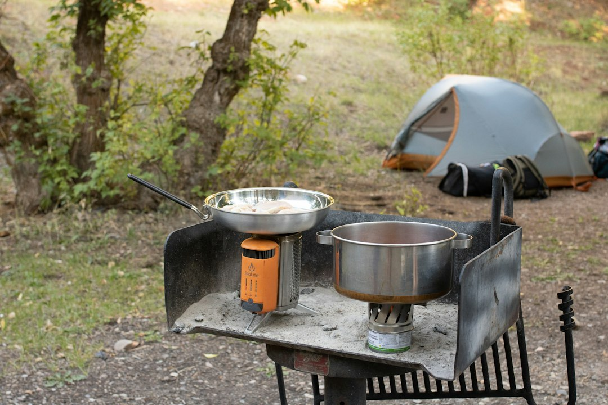

*This post contains affiliate links. As an Amazon Associate, I earn from qualifying purchases at no extra cost to you.*

Most overlanders overspend on the wrong half of their cooking setup. They buy a $400 slide-out drawer system before they know how they cook, then discover they eat the same four meals and could have done it all with a stove, one pot, and a plastic bin. The better path is to build the camp kitchen around your actual menu, your vehicle's payload, and the number of people you feed, and to buy only the pieces that solve a real problem.

My position is simple: start with a modular, grab-and-go kitchen, not a permanent install. A bin-based kit costs less, moves between vehicles, survives a vehicle sale, and lets you fix mistakes cheaply. Permanent drawers make sense only after a season or two of real trips tell you what you reach for most.

This guide walks through stove choices, a DIY box layout, cookware, fuel and water logistics, a repeatable campsite setup routine, and the mistakes that waste money or create hazards. Prices and specs are drawn from manufacturer documentation and owner reports, so verify current details before buying.

Photo by <a href="https://unsplash.com/@lydiavenjohn?utm_source=artlines_blog&utm_medium=referral">Lydia Venjohn</a> on <a href="https://unsplash.com/?utm_source=artlines_blog&utm_medium=referral">Unsplash</a>

## Why a DIY Camp Kitchen Beats a Pre-Built Kit

Pre-built overlanding kitchens are attractive because everything is matched and packed. The tradeoff is cost, weight, and fixed assumptions. A typical branded kitchen box bundles items you may already own, such as a cutting board, spice containers, and utensils, and prices them at a premium. You also inherit someone else's idea of what a meal looks like.

A DIY system flips that. You decide what a typical dinner needs, then pack exactly that. For a solo traveler or couple, that often means one burner, one pot, one pan, a kettle or boil cup, two plates, two cups, a knife, a spatula, a cutting board, and a cleanup kit. That list fits in a single 27-gallon-class tote or two smaller bins, and most of it is already in a kitchen drawer at home.

Weight matters more than most budget builders expect. Cookware, fuel, water, and food add up fast, and they sit in the same cargo area as recovery gear and spares. Before you pile on drawers and tables, check your numbers using our guide on [how to determine payload capacity and safe weight limits for your vehicle](/2026/09/19/how-to-determine-payload-capacity-and-safe-weight-limits-for-your-vehicle/). A steel-framed kitchen module can easily eat 40 to 60 pounds before you add a single can of food.

The other advantage of a DIY approach is repairability. A cracked plastic bin costs a few dollars. A damaged proprietary slide system can mean a full replacement. Keep your first build cheap, note what annoys you for three trips, then upgrade the single weakest link.

## Choosing a Portable Cooking System

The stove decides almost everything else in your kitchen: fuel type, pot choice, storage footprint, and how much wind protection you need. Most budget overlanders end up choosing among four categories.

| System | Best for | Typical strengths | Main tradeoffs |
|---|---|---|---|
| Integrated canister stove (Jetboil-style) | Solo or couple, boiling water, quick meals | Fast boil, compact, built-in windscreen effect | Poor for simmering and frying, canister cost |
| Two-burner propane camp stove | Families, real cooking, multiple pots | Stable platform, adjustable flame, cheap fuel per meal | Bulky, needs a table, regulator and hose care |
| Single-burner canister stove | Minimalists, backup stove | Very small, inexpensive | Tippy with big pans, wind sensitive |
| Liquid fuel or multi-fuel stove | Remote, long trips, cold weather | Fuel available worldwide, cold tolerant | Higher cost, priming and maintenance |

For most beginners, I recommend a two-tier setup: an integrated boil system for coffee, oatmeal, and freeze-dried or one-pot meals, plus a larger stove only if you cook for three or more people or fry food regularly. The [Jetboil Flash 1.0L Fast Boil Stove for Camping and Backpacking, Carbon](https://www.amazon.com/dp/B0DXQCVVYB?tag=budgetoverlander-20) is an example of the integrated category, sold as a fast-boil stove. Actual boil times vary: wind, cold, and altitude all slow things down, so treat any manufacturer boil-time figure as a best case.

The main limit is that integrated systems are designed for boiling. They scorch thin sauces and are awkward for pancakes or eggs unless you add a separate pan accessory. If your trips involve breakfast scrambles and real stir-fry, a two-burner stove earns its space. If your trips are coffee, hot lunches, and rehydrated dinners, the integrated system is the better value because it uses less fuel and packs smaller.

### Safety warning: gas appliances and carbon monoxide

Never cook inside a closed vehicle, tent, or rooftop tent enclosure. Burning propane, butane, or liquid fuel produces carbon monoxide, which you cannot smell and which can incapacitate you before you notice symptoms. The U.S. Consumer Product Safety Commission's [carbon monoxide information center](https://www.cpsc.gov/Safety-Education/Safety-Education-Centers/Carbon-Monoxide-Information-Center) explains why fuel-burning camping equipment should stay outdoors, and a battery-powered CO alarm is a cheap precaution if you ever shelter in a vehicle in bad weather.

Also check hoses, regulators, and canister connections for cracks or leaks before each trip. Brush soapy water over the connections and watch for bubbles. Keep a fire extinguisher within reach of the cooking area and mounted where you can grab it quickly. Our [vehicle fire extinguisher guide](/2026/06/04/vehicle-fire-extinguisher-guide-what-to-carry-and-where-to-mount-it/) covers what to carry and where it should live. If you smell gas, see damaged fittings, or a canister is dented or rusting, stop using it and replace it.

## Building the DIY Camp Kitchen Box and Layout

A good kitchen layout has three zones: a cooking zone, a prep zone, and a cleanup zone. In a vehicle-based setup, you create those zones with a table, a stove surface, and a washing station, and you pack everything into containers that move between them.

**The box.** Start with one sturdy, lidded tote about 20 to 27 gallons. Choose one with a flat lid that can serve as a temporary prep surface, and check the load rating for stacking. Inside, add a few inexpensive dividers or small zippered pouches to separate tools, spices, and cleanup items. A second smaller bin holds dry food. Label both on the end so you can identify them in a stack.

**The table.** A flat, stable work surface is the real luxury. Many overlanders use a folding table, the tailgate, or a dedicated folding kitchen stand. The [Coleman Pack-Away Portable Camp Kitchen](https://www.amazon.com/dp/B00339912S?tag=budgetoverlander-20) is an example of the folding stand approach, with a food prep area. Stands like this suit car camping and campsite-based trips well. The tradeoff is that folding legs on soft sand or uneven ground can wobble, and a stand with a lot of fabric or plastic panels should be kept well away from open flames and hot cookware. Place the stove on a stable section designed for it and check the manufacturer's instructions for stove weight and burner limits.

**Layout principle.** Keep the stove downwind of your sleeping area, with clear space around it. Put the prep area to your dominant hand's side, the water jug at hand height, and the trash bag where it cannot blow away. If you use the tailgate, make sure the vehicle is parked on level ground and the tailgate is rated to carry load.

**Lighting and power.** A cheap headlamp solves most kitchen lighting issues. If you add a 12-volt light strip or lantern, run it from a properly fused circuit. Our guide to a [DIY dual battery setup for overlanders under 300 dollars](/2026/09/12/diy-dual-battery-setup-for-overlanders-under-300-dollars/) explains how to power small accessories without draining your starting battery.

**Doing it for under $200.** If budget is the main constraint, our walkthrough on [how to set up a camp kitchen in your vehicle for under 200](/2026/06/10/how-to-set-up-a-camp-kitchen-in-your-vehicle-for-under-200/) breaks down the parts list in detail. The short version is to spend on the stove, a reliable pot set, and a stable surface, and to scavenge everything else.

## Cookware, Fuel, Water, and Food Storage

Cookware is where many builders either overbuy or underbuy. The right set is one that nests, cleans easily, and matches your meals.

**Pots and pans.** Stainless steel is durable, resists scratching from metal utensils, and handles abuse from rocky campsites. Aluminum heats faster and weighs less but dents and can discolor. Nonstick pans make cleanup easier but the coating is damaged by metal tools and high heat. For budget kits, a stainless set is a strong all-rounder. The [GSI Outdoors Glacier Stainless Camper 4 Person Packable Cookware & Dinnerware Set](https://www.amazon.com/dp/B0773K5R67?tag=budgetoverlander-20) is a packable stainless cookware and dinnerware option for a group of four, and buying a set rather than assembling pieces individually keeps your cookware and dinnerware together in one kit. Stainless is slower to heat evenly than aluminum, so use a lower flame and stir more often to avoid hot spots.

**Fuel.** Canister fuel (isobutane and propane blends) is convenient, but it performs poorly in cold weather because the canister cools as it vents. Standard 16-ounce propane cylinders are cheaper per meal and widely available, and refill adapters exist for some setups. Carry one more canister than you think you need, store fuel outside the passenger cabin when possible, and keep it away from heat sources. If your route includes international travel or remote areas, confirm what fuel types are sold locally, since canister threads and gas blends vary by country.

**Water.** Cooking and cleanup use more water than most beginners plan for. A rough planning figure is about one gallon per person per day for drinking and cooking, plus extra for dishes. Our guide to [portable water filters and storage systems for remote overlanding](/2026/09/17/best-portable-water-filters-and-storage-systems-for-remote-overlanding/) covers how to carry and treat water so you are not rationing it at camp.

**Food storage.** Keep food and trash sealed, and in bear country follow local regulations for food storage. Leave No Trace's [seven principles](https://lnt.org/why/7-principles/) are the standard reference for disposing of waste, washing dishes at least 200 feet from water sources, and minimizing campfire impact. Cold storage is a separate decision with a huge cost range, so see our [off road refrigeration and cooler solutions compared](/2026/10/06/off-road-refrigeration-and-cooler-solutions-compared-budget-to-premium/) before assuming you need a powered fridge. A well-packed cooler with block ice handles weekend trips for a fraction of the cost.

**Cleanup kit.** Pack a small tub for washing, biodegradable soap, a scrub pad, a microfiber towel, and a strainer for food scraps. Strain gray water, pack out solids, and scatter dishwater broadly away from streams. Pre-wiping greasy pans with a paper towel saves water and keeps the cleanup simple.

## Setting Up Your Camp Kitchen: A Repeatable Routine

A consistent routine keeps the kitchen safe and fast, especially when you arrive at camp tired or at dusk. Follow the same steps each time so nothing gets forgotten.

1. **Pick the location first.** Choose a flat, open spot at least 10 to 15 feet from your tent or vehicle cabin, downwind of sleeping areas, and clear of dry grass, overhanging branches, and loose debris. Check local fire restrictions, since some areas ban open flames and even certain stoves during dry seasons.
2. **Level and set the table.** Open the folding stand or table, check that all legs are locked, and press down on it to confirm stability. Add shims or flat rocks if needed. A wobbly table is the most common cause of spilled boiling water.
3. **Place the stove and check connections.** Set the stove on a stable heat-resistant surface, attach the fuel, and check for leaks with a quick sniff and a soapy-water test if anything seems off. Position a windscreen if the manufacturer allows one for your model, since some stoves can overheat the canister if a screen is placed incorrectly.
4. **Stage everything before lighting.** Put out ingredients, pots, utensils, and water within reach, and set up the washing station. Moving around a lit stove looking for a spatula is when accidents happen.
5. **Cook and keep watch.** Never leave a lit stove unattended, keep children and pets clear, and keep your extinguisher within reach.
6. **Cool, clean, and pack.** Let the stove and pots cool before packing. Wash dishes, strain scraps, seal food, and secure trash. Return items to their labeled spots so the next setup starts clean.
7. **Do a final sweep.** Scan the ground for dropped utensils, bits of food, and microtrash, then confirm the stove is off and the fuel is disconnected or stored properly.

Run this routine a few times at home or in a campground before relying on it on a remote trip. Rehearsal exposes missing items cheaply.

## Common Camp Kitchen Mistakes to Avoid

Most kitchen problems come from planning errors, not bad gear. These are the ones that cost overlanders the most money and frustration.

**Buying the kitchen before defining the menu.** A two-burner stove, a griddle, and a Dutch oven look great in photos, but if you mostly make coffee and one-pot meals, they are dead weight. Write down your ten most common trail meals and buy only what they require.

**Ignoring wind.** Wind steals heat, wastes fuel, and can blow flames sideways toward tables or fabric. Park the vehicle to shelter the stove, use the manufacturer-approved windscreen, and avoid cooking under awnings or tarps where heat and exhaust can gather.

**Cooking in enclosed spaces.** Cooking inside a vehicle, tent, or rooftop tent in rain is tempting and dangerous because of carbon monoxide and fire risk. Set up an awning with open sides, or wait out the weather and eat a cold meal.

**Overloading folding furniture.** Light folding kitchens have weight limits for the table surface and for stove placement. Heavy cast iron, full water jugs, and a loaded stove can exceed them. Check the manufacturer's rating and keep heavy items low.

**Neglecting fuel strategy.** Running out of fuel on day two of a five-day trip ends the plan. Estimate fuel by counting meals, add a reserve, and know where resupply is on your route.

**Poor water and waste handling.** Washing dishes in a creek, leaving scraps, or running short of water creates safety and legal problems. Plan water volumes before you leave and follow Leave No Trace guidance.

**Skipping maintenance.** Clogged burners, old seals, and cracked hoses cause failures at the worst time. Clean burners, inspect seals, and test the stove at home before every trip. If the flame looks weak or yellow instead of mostly blue, stop and diagnose the problem before using it for real meals.

## FAQ

**How much should I spend on a DIY camp kitchen?**

A functional starter kit can come in under $150 to $200 if you reuse household cookware and buy only a stove, a stable surface, and a cleanup kit. Spend more on the stove and any item that affects safety, such as hoses, regulators, and fire protection, and less on accessories like specialty racks and branded containers. The best budget approach is to build in stages. Take the first three or four trips with a simple kit, record what you wish you had, and upgrade only those items. That prevents spending on gear that adds weight without improving meals.

**Is a two-burner stove better than a Jetboil-style system?**

It depends on what you cook. A two-burner stove is better for families, frying, simmering, and preparing several dishes at once. A Jetboil-style integrated system is better for solo travelers and couples who mostly boil water for coffee, oatmeal, and rehydrated meals, because it is compact and fast to boil. Many overlanders carry both: the integrated system for fast mornings and a bigger stove for dinner. If you can only buy one and you cook for more than two people, choose the two-burner. If you cook for one or two, start with the integrated system.

**Can I cook inside my vehicle or rooftop tent if it is raining?**

You should not. Fuel-burning stoves produce carbon monoxide, and enclosed fabric or vehicle spaces can trap it quickly. They also create fire risk near bedding, tent fabric, and gear. Instead, use a ventilated awning with open sides, cook under the lifted tailgate with the stove well clear of the vehicle, or switch to no-cook meals during storms. If you must shelter in a vehicle, keep the stove outside and consider a battery-powered CO alarm. Always follow the stove manufacturer's instructions and local safety guidance.

**What cookware material is best for overlanding?**

Stainless steel is the most practical choice for rough use. It tolerates scratching, high heat, and abuse, and it cleans easily, although it heats less evenly than aluminum. Aluminum is lighter and heats quickly but dents and can react with acidic foods. Nonstick coatings simplify cleanup but wear out when scrubbed or used over high heat. For a first kit, a nested stainless set gives you durability and storage efficiency, and you can add one nonstick or cast iron pan later if your menu calls for it.

## Conclusion

A good overlanding kitchen is simple, safe, and matched to how you actually eat. Start with a stove that fits your group size, add one reliable pot set, secure a stable work surface, and pack everything in labeled bins. Follow a consistent setup routine, keep fire and carbon monoxide safety front of mind, and plan your water and fuel before you leave.

Your next step is to write down your ten most common trail meals, then check them against your current gear. Whatever is missing is your shopping list, and everything else can stay at home.

Bookmark this guide and check the related posts below before your next trip.

**Related reading**

- [How To Set Up A Camp Kitchen In Your Vehicle For Under 200](/2026/06/10/how-to-set-up-a-camp-kitchen-in-your-vehicle-for-under-200/)
- [Off Road Refrigeration And Cooler Solutions Compared Budget To Premium](/2026/10/06/off-road-refrigeration-and-cooler-solutions-compared-budget-to-premium/)

  
<strong>About the Author</strong>

  
The Budget Overlander team researches trail-ready vehicle builds with an eye on cost and practicality. Our guides draw from forum-documented builds, manufacturer specs, and owner reviews - so you know what to expect before you buy.

