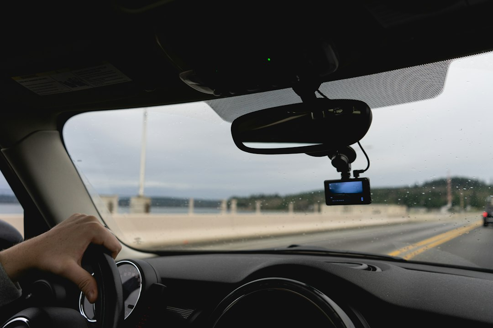

*This post contains affiliate links. As an Amazon Associate, I earn from qualifying purchases at no extra cost to you.*

A dash camera costs less than a decent set of recovery straps, and it is the only piece of gear that can settle an argument after the fact. For overlanders, that job covers more ground than it does for commuters. You drive highways to reach the trailhead, share washboard roads with logging trucks and ranch traffic, leave the rig parked at remote pullouts for days, and sometimes want to review a tricky line you just crawled. A camera that handles all of that has to be tougher and smarter than the typical commuter unit.

The position here is simple. Most budget builders should buy a dependable 1440p-or-better camera with GPS, a heat-tolerant design, and a high-endurance microSD card, then put the leftover effort into a clean hardwire install. Spec-sheet resolution matters less than a camera that survives a sun-baked dashboard in July and boots every time you turn the key. Below you will find what to look for, how footage helps with insurance, three cameras worth shortlisting, and the power mistakes that quietly ruin otherwise good setups.

Photo by <a href="https://unsplash.com/@nicoletarasuk?utm_source=artlines_blog&utm_medium=referral">Nicole Logan</a> on <a href="https://unsplash.com/?utm_source=artlines_blog&utm_medium=referral">Unsplash</a>

## What Off Road Footage Demands From a Camera

Trail driving punishes cameras in ways pavement does not. Constant vibration loosens cheap mounts, triggers the impact sensor, and smears the image if the shutter speed and processing are not up to it. Dust coats the windshield, and light swings from deep canyon shade to full sun in seconds. Judge every camera against those conditions, not against a smooth-road demo clip.

### Sensor, resolution, and frame rate

The sensor matters more than the headline resolution. STARVIS 2 sensors, which all three picks below list, are built for low-light performance. That helps at dawn and dusk, when animals and unlit vehicles are most likely to appear. For resolution, 1440p is a practical floor for reading plates at a reasonable distance, while 2.7K or 4K gives you more room to crop. Frame rate is the underrated spec. A 60fps mode, advertised in both the VIOFO and Vantrue listings, keeps passing vehicles and fast-moving scenery from smearing, which matters when the whole frame is shaking over corrugation.

### HDR and glare

Tree-lined trails produce harsh contrast. HDR processing, listed on all three cameras, balances shadows and highlights so a plate under a dark canopy is not a black blob. Some dash cams also accept a circular polarizer filter that cuts dashboard reflections on the glass, so check whether your model supports one before you buy.

### Storage and file protection

Constant writing wears out ordinary microSD cards, so buy one sold as high endurance and reformat it in the camera about once a month. The G-sensor locks a clip when it detects an impact, but on rough trails it can trigger on every rut and fill the protected folder with junk. Lower the sensitivity until a hard bump does not lock footage, yet keep it high enough to catch a real collision. A camera that overwrites the one clip you need is worse than no camera, because it gives you false confidence.

## Insurance Protection With Dash Cameras for Overlanders

Footage protects you most in the boring situations. A pickup drifts across the centerline on a gravel road, someone rear-ends you at a fuel stop, or a driver changes lanes into your trailer on the highway. Without video, you have your word against theirs. With video, you have a timestamped record, often with GPS speed and location, that an adjuster can review in minutes. Overlanders log heavy highway mileage getting to the dirt, so most of your collision exposure still sits on pavement.

Parked protection matters too. Trailhead break-ins, door dings, and hit-and-run damage happen while you are away from the rig. The VIOFO listing advertises a buffered 24-hour parking mode, the Vantrue lists 24/7 parking mode, and the Thinkware lists dual radar parking mode. Each approach captures events while the vehicle sits, though how well it works depends on your power setup.

Set realistic expectations. Footage does not guarantee a claim outcome, and it does not reliably earn a premium discount. Dash cam video is generally treated as evidence, not a rating factor, so call your carrier and ask whether any discount exists and how they want video submitted. Also read your policy language on off-road use. Many policies limit or exclude damage away from public roads, and a camera cannot fix an exclusion. If you want clarity, ask your agent to confirm in writing how an on-trail incident would be handled.

Good evidence habits make footage count:

- Save the clip immediately after any incident and copy it to your phone or cloud storage before the card overwrites it.
- Keep the original file unedited and hand that file to the adjuster.
- Remember that GPS speed stamps cut both ways. If you were speeding, the video shows it, so drive as though someone will watch it.

Two legal points deserve a quick check. Audio recording laws vary by state and by country, and cabin cameras capture passengers, so read the [Reporters Committee recording guide](https://www.rcfp.org/reporters-recording-guide/) and tell anyone riding with you. Mounting position rules also vary, and some states restrict what you can attach to the windshield. California's [Vehicle Code section 26708](https://leginfo.legislature.ca.gov/faces/codes_displaySection.xhtml?lawCode=VEH&sectionNum=26708) is a well-known example, so check your own state's version before you stick anything to the glass.

## Best Dash Cameras for Overlanders: Three Picks

The specs below come from the supplied product listings, not from hands-on testing, so confirm current details and what is included in the box before you buy. Each pick suits a different use case.

### VIOFO A119 Mini 2: best value front camera

The [VIOFO A119 Mini 2](https://www.amazon.com/dp/B0C5MVB7NX?tag=budgetoverlander-20) is the default recommendation for a budget build. The listing advertises a STARVIS 2 sensor, 2K 60fps recording with 1440p front recording, HDR night vision, voice control, 5GHz Wi-Fi, GPS, buffered 24-hour parking mode, and a supercapacitor. That last item matters. Supercapacitors generally tolerate temperature extremes better than lithium batteries, which is a real advantage in a vehicle that bakes at a trailhead. Wi-Fi can make it easier to review clips on your phone without prying out the card.

The tradeoff is coverage. It is front only, so you get no rear or cabin view. Check whether a hardwire kit is included, since you will want one for parking mode.

### Vantrue N2X: best for front and cabin coverage

The [Vantrue N2X](https://www.amazon.com/dp/B0D9GRRXH5?tag=budgetoverlander-20) pairs a front camera with an inside camera. The listing advertises 2.7K recording, an IMX675 STARVIS 2 sensor, HDR plus infrared night vision, an F/1.8 aperture, 5G Wi-Fi, GPS, 60fps, voice control, a G-sensor, and 24/7 parking mode. The infrared cabin view is the draw if theft is your main worry, because it may show who entered the vehicle at night. It can also document your interactions at a traffic stop, provided local law allows it.

The tradeoff is privacy. An interior camera records you and your passengers, so audio laws and consent matter more here. It also does not cover what is behind you.

### THINKWARE U3000 PRO: best premium pick

The [THINKWARE U3000 PRO](https://www.amazon.com/dp/B0FP137YT4?tag=budgetoverlander-20) is the step-up option. The listing advertises 4K front and 2K rear recording with dual STARVIS 2 sensors, dual radar parking mode, thermal protection, LTE compatibility, 5GHz Wi-Fi, GPS, HDR, and a free 64GB card and OBD cable. A rear channel is valuable on dusty roads with trucks close behind and for documenting rear-end impacts. Thermal protection is useful for hot climates, and the included card and cable reduce add-on costs.

The tradeoffs are price, size, and wiring. Routing a rear camera takes time, and LTE features generally require extra hardware and a data plan. A rooftop box, spare tire carrier, or trailer can also block the rear view.

### Quick comparison

| Camera | Channels | Listed resolution | Parking mode (listed) | Best for | Main tradeoff |
|---|---|---|---|---|---|
| VIOFO A119 Mini 2 | Front | 1440p, 60fps | Buffered 24H | Budget builds, hot climates | No rear or cabin view |
| Vantrue N2X | Front and inside | 2.7K, 60fps | 24/7 parking mode | Theft and cabin coverage | Privacy and audio laws |
| THINKWARE U3000 PRO | Front and rear | 4K front, 2K rear | Dual radar | Highway and dusty-road rear coverage | Cost and install effort |

For most readers, the VIOFO is the right buy. Pick the Vantrue if cabin break-ins or documenting stops worries you more than anything behind you. Pick the Thinkware if you drive long highway stretches, want rear coverage, and can absorb the cost.

## Power, Parking Mode, and Heat

A dash camera is only as reliable as its power. Plugging into a cigarette lighter works for driving, but it leaves you without parking protection and with a cable dangling across the cabin. A hardwire kit solves both problems, and an OBD cable, such as the one listed with the Thinkware, offers a simpler route on vehicles that support it.

Parking mode draws power even when the engine is off, which is where overlanders get into trouble. If you already run an auxiliary battery, feed the camera from that fused circuit instead of the starting battery. Our [dual battery setup guide](/2026/09/12/diy-dual-battery-setup-for-overlanders-under-300-dollars/) covers the wiring principles, and a low-voltage cutoff on the hardwire kit keeps the camera from draining the battery your engine needs.

> **Safety warning:** Hardwiring involves vehicle electrical work. Disconnect power before touching fuse boxes, use a fuse tap rated for the circuit, and never tap or route wire through airbag circuits or airbag deployment zones. If you are unsure which circuits are safe, have a professional installer do the job.

Heat is the other threat. Park in shade when possible and use a windshield sunshade. A supercapacitor design and thermal protection, both listed on products above, help but do not make a camera immune to a closed vehicle in desert sun.

### Basic install steps

1. Choose a mount spot behind the rearview mirror, outside the wiper sweep and within your local mounting rules, then clean the glass with isopropyl alcohol.
2. Route the cable along the headliner and down the A-pillar, keeping it clear of the airbag seam and tucked into trim.
3. Connect the hardwire kit through fuse taps, one on a switched circuit and one on a constant circuit, and secure the ground to a bare metal bolt.
4. Set the low-voltage cutoff conservatively, above the voltage your engine needs to start.
5. Format the card in the camera, set the time and GPS, and adjust G-sensor sensitivity for your terrain.
6. Record a test clip in daylight and at night, then check that plates and surroundings are legible.

## Common Mistakes and Problems to Avoid

Most dash cam failures come from setup, not the camera. These are the problems that show up repeatedly.

- **Buying on resolution alone.** A 4K camera with a weak mount or poor heat tolerance records less useful footage than a reliable 1440p unit that survives summer.
- **Using a standard microSD card.** Non-endurance cards fail under constant rewriting, often without warning. Buy a high-endurance card and replace it on a schedule.
- **Running parking mode off the starting battery with no cutoff.** This is the quickest way to a dead battery at a remote trailhead, and the breakdown that follows is far costlier than the camera. Our guide on [handling a breakdown on the trail](/2026/06/11/how-to-handle-a-breakdown-on-the-trail/) covers what to do if it happens.
- **Leaving G-sensor sensitivity at default.** Rough roads can lock dozens of clips, burying the one you need. Test and adjust before your first trip.
- **Never checking your footage.** Cards and cables can fail silently. Play back a clip every month and confirm the date, GPS, and image are intact.
- **Ignoring the lens.** Dust and film on the windshield wash out footage. Clean the glass before every trip.
- **Overwriting or editing evidence.** After an incident, copy the original file, keep it untouched, and remove the card if needed to prevent loop recording from deleting it.

## FAQ

### Do I need a rear camera for overlanding?

Not always, but it earns its place if you drive a lot of highway or gravel with traffic behind you. Rear-end collisions often turn into fault disputes, and a rear channel records the tailgater, the plate, and the impact. The tradeoff is cost and wiring complexity. If your rear window is blocked by a rooftop box, spare tire carrier, or trailer, a rear camera may see only gear, which defeats the purpose. In that case, a quality front camera plus careful driving habits is the smarter spend, and you can revisit a dual-channel model like the Thinkware U3000 PRO later if your use changes.

### Will a dash cam lower my insurance premium?

Not reliably. Dash cam footage is usually treated as evidence in a claim, not as a rating factor, and most standard policies do not advertise a discount simply because you own one. Some carriers run telematics programs that track driving through an app or plug-in device, and those are separate from a dash cam. Call your agent and ask two questions: whether any discount exists, and how the company wants video submitted during a claim. Also ask how your policy treats damage that occurs off public roads. The camera's real value is faster fault decisions and protection against false claims.

### Is parking mode safe for my battery?

Parking mode is safe when you control the voltage cutoff. A hardwire kit with a low-voltage cutoff stops the camera drawing power before the battery falls below the level your engine needs to start. Buffered parking modes, such as the one VIOFO lists for the A119 Mini 2, save the seconds before a trigger, but any parking mode still draws power. The safest approach for long stays is a separate auxiliary battery with a fused feed. If you camp for several days without driving or solar charging, consider turning parking mode off or using a battery pack made for dash cams.

### Can I use a dash cam to film my trail runs?

You can, with limits. A 60fps front camera captures smooth enough clips of crawling and washboard to review lines or share with friends, and GPS stamps record where and how fast you were going. But dash cams are fixed forward, wide, and tuned for evidence, not cinematic angles. Hood and dashboard reflections will appear in the frame. If content creation is a priority, a dedicated action camera on a suction or roll bar mount gives better angles and stabilization, while the dash cam stays on duty as your insurance record. Keeping the roles separate also keeps your evidence files untouched.

## Conclusion

The best dash cam for your rig is the one that records reliably through heat, vibration, and long highway days, not the one with the biggest number on the box. For most budget overlanders, that means the VIOFO A119 Mini 2 with a high-endurance card and a proper hardwire install. Choose the Vantrue N2X if cabin theft concerns you, or the Thinkware U3000 PRO if rear coverage and premium features justify the spend.

Your next step is concrete: pick one camera, order a high-endurance card, and block out an afternoon for a careful install. Then drive a test route, review the footage, and tune the G-sensor before your next trip.

Bookmark this guide and subscribe by RSS for more budget build breakdowns.

**Related reading**

- [Best Recovery Gear Kit Under 500 Essentials](/2026/06/17/best-recovery-gear-kit-under-500-essentials/)
- [How To Upgrade Your Vehicle Charging System For Auxiliary Loads And Accessories](/2026/10/08/how-to-upgrade-your-vehicle-charging-system-for-auxiliary-loads-and-accessories/)

  
<strong>About the Author</strong>

  
The Budget Overlander team researches trail-ready vehicle builds with an eye on cost and practicality. Our guides draw from forum-documented builds, manufacturer specs, and owner reviews - so you know what to expect before you buy.

