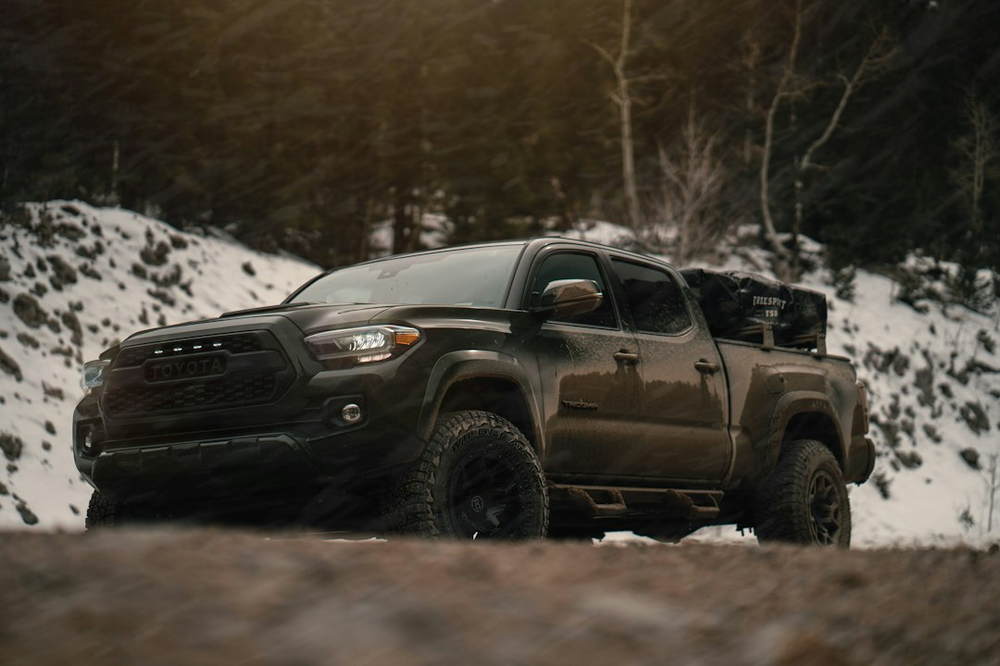

*This post contains affiliate links. As an Amazon Associate, I earn from qualifying purchases at no extra cost to you.*

Rocker panels are the most expensive sheet metal to ignore on an off-road vehicle. They sit low, they are the first thing to meet a ledge, and they double as the structure that ties the cabin together. Crush one against a rock and you are looking at door gaps that never close right, a pinched floor seam, and a body shop bill that dwarfs the cost of any slider you could have bought.

Here is the position this guide takes: for most budget builders, DIY rock sliders are the better value only if you already have welding skill and a place to work. If you do not, a well-matched aftermarket kit wins, because a bad weld or a bad mounting plan costs more than the money you saved. Body armor is different. Coatings, skid plates, and rocker protection are mostly a DIY win for nearly everyone.

Below you will find a real cost comparison, a step-by-step build outline, a buying framework for kits, and the mistakes that turn cheap protection into expensive repairs.

Photo by <a href="https://unsplash.com/@clintmckoy?utm_source=artlines_blog&utm_medium=referral">Clint McKoy</a> on <a href="https://unsplash.com/?utm_source=artlines_blog&utm_medium=referral">Unsplash</a>

## What rock sliders and body armor actually protect

Before comparing prices, be clear about the job. Rock sliders are structural bars that run along the rocker area between the wheels. They do two things: they take impact so your rocker panels do not, and they give you a sacrificial surface to slide or pivot on when the vehicle is hung up. A good slider transfers load into the frame or the reinforced body mounting points, not into thin sheet metal.

That last point is the whole game. A tube that looks tough but bolts to a pinch weld will fold the rocker the first time it takes real weight. Manufacturer fitment notes on most kits emphasize frame attachment for exactly this reason.

"Body armor" is a broader category. It usually covers:

- **Skid plates** for the engine, transmission, transfer case, and fuel tank
- **Rocker and sill guards** that fill the gap between sliders and body
- **Bumper and corner protection** for approach and departure angles
- **Coatings and sealants** that protect bare steel from rust, rock chips, and moisture

Think of these as layers. Sliders handle big hits on the sides. Skid plates handle the underside. Coatings handle the slow damage that no amount of steel will stop. Spending your entire budget on one layer and ignoring the others is a common trap, and it leaves you with a vehicle that is armored on the outside and rotting from the inside.

The terrain you run decides how much you need. Gravel roads and forest service tracks call for modest protection. Rocky ledges, washouts, and technical trails justify full-length sliders and proper skids. If your trips are mostly graded dirt, a coating and a skid for the oil pan may be all the armor you need.

## DIY or Aftermarket: Cost, Building, and Buying

### The real cost picture

The sticker price comparison is misleading, so break it into categories. A DIY build looks cheap because you only see steel. The real total includes the tools you do not own, the consumables, and the cost of mistakes.

Here is a practical comparison. Treat the dollar figures as planning ranges and confirm current prices with local steel suppliers and the product listings, since both move.

| Factor | DIY build | Aftermarket kit |
|---|---|---|
| Material or kit cost | Often the lowest line item for steel tube and plate | Higher, includes engineering and brackets |
| Tools required | Welder, grinder, drill, cutting tools, clamps | Basic hand tools and a jack |
| Skill required | Welding, fabrication, templating | Bolt-on installation |
| Fitment risk | You own it entirely | Low if the kit matches your exact model |
| Time | Multiple weekends | A few hours |
| Strength confidence | Depends on your welds and design | Backed by manufacturer design |
| Customization | Unlimited | Limited to the kit design |
| Resale value | Varies, buyers distrust unknown welds | Recognizable brand helps |

The table shows why the answer depends on you. If you already own a welder and have practiced on structural joints, DIY savings are real. If you are buying a welder, a grinder, a set of clamps, and safety gear, the savings shrink quickly. A kit starts to look reasonable once you add up a first-time tool purchase.

Our existing guide on [DIY rock sliders: materials, templates, and welding on a budget](/2026/06/28/diy-rock-sliders-materials-templates-welding-budget/) covers the fabrication details in depth. This post focuses on the decision itself, so use that one as your build reference if you go the DIY route.

The main tradeoff is simple. DIY trades money for time, risk, and skill. A kit trades money for certainty. Neither is wrong. What is wrong is choosing DIY because it feels more authentic, then discovering halfway through that your welds are not what the job needs.

### Building DIY rock sliders on a budget: a step-by-step approach

If you decide to build, follow a disciplined process. Sloppy planning is where budget builds go wrong.

**Safety first.** Welding, grinding, and cutting involve fire, UV exposure, fumes, and flying metal. Read the [OSHA welding, cutting, and brazing guidance](https://www.osha.gov/welding-cutting-brazing) before you strike an arc, wear a proper helmet and respirator-appropriate protection for fumes, and keep a fire extinguisher within reach. Disconnect the vehicle battery before welding near the body, shield fuel lines, brake lines, and wiring, and never weld near a fuel tank without removing or fully protecting it. Support the vehicle on rated jack stands on level ground, never on a jack alone.

Here is a workable build sequence:

1. **Measure and template.** Make cardboard or thin sheet templates of the rocker area and the frame mounting locations. Mark where the frame rails, body mounts, or reinforced pinch points sit. This step prevents most fitment disasters.
2. **Choose your material.** Rectangular tube (commonly 2 by 3 inch or 2 by 4 inch) and round tube both work. Wall thickness matters more than shape. Thicker wall is heavier but far more forgiving of impact. Buy from a local steel supplier and ask about offcuts to save money.
3. **Design the mounts.** Plan to attach to the frame through gusseted plates or brackets, not to the rocker itself. Make the mounts bolt-on if you can, so you can remove the sliders for service.
4. **Cut and fit dry.** Cut your tube, tack the pieces together, and test fit under the vehicle before any final welding. Check ground clearance, door opening, and step height.
5. **Weld with proper penetration.** Practice on scrap of the same thickness first. Good penetration and clean fusion matter more than pretty beads. Weld mounting plates fully rather than with spot tacks.
6. **Grind, prep, and coat.** Remove slag, break sharp edges, clean off mill scale and oil, and apply a protective coating (more on that below).
7. **Install and torque.** Use grade-appropriate hardware, add thread locker, and torque to a sensible spec. Recheck after your first few trail days.

A few design choices are worth defending. Bevel or round the leading and trailing ends so the slider ramps over obstacles instead of catching them. Keep the tube tucked as high as your clearance needs allow, because a slider that hangs too low becomes the lowest point on the vehicle and a pivot that lifts your wheels off the ground. And consider a small step or tread surface if you plan to use the slider for entry, since bare round tube is slippery when wet.

### Buying an aftermarket kit without overpaying

Kits make sense when your time, tools, or confidence are limited. The goal is to buy once, fit correctly, and avoid paying for features you will not use.

Start with exact fitment. This is the single biggest source of returns and regret. Confirm your model, year range, body style (two-door versus four-door, standard cab versus extended), and wheelbase against the listing, and read the fitment notes closely. Some universal-looking products are model specific.

Two supplied examples show how different the category can be:

- The [SmittyBilt SRC Side Armor (SB76634)](https://www.amazon.com/dp/B003EOZLEO?tag=budgetoverlander-20) represents the traditional side armor approach, a design aimed at protecting the body sides. Verify the listing's fitment information against your exact vehicle before ordering.
- The [Assault Industries Can-Am Maverick X3 MAX Rock Sliders](https://www.amazon.com/dp/B0DVVYK9Z9?tag=budgetoverlander-20) is a reminder that sliders are not just for trucks and SUVs. This one is specific to the Can-Am Maverick X3 MAX, so it is only relevant if you run that machine. It also illustrates why fitment checking matters: a product built for one platform will not work on another.

Both are candidates to evaluate against your own vehicle, not blanket recommendations. Read the current listing, check the included hardware, and compare owner reviews for fitment notes and finish quality.

Use this decision framework when choosing between DIY and a kit:

- **Choose DIY if** you own or can borrow a welder, have welded structural joints before, want a custom design for an unusual vehicle, and can spend several weekends on it.
- **Choose a kit if** you have never welded structure, your vehicle has a popular platform with good kit support, you need protection before a specific trip, or your time is worth more than the savings.
- **Choose a hybrid if** you want the savings of DIY with less risk. Buy a kit, or a set of model-specific mounting brackets, and handle the finishing, coating, and any modifications yourself.

The hybrid route is underrated. Bolt-on kits often ship bare or with a basic finish, and a proper coating job costs little while extending their life considerably.

When weighing price, include shipping on heavy steel, the cost of hardware, and any frame drilling or trimming the install requires. A cheaper kit that needs extra fabrication stops being cheaper.

## Body armor beyond sliders: skid plates, rocker guards, and coatings

Sliders get the attention, but the underside is where many budget builds quietly fail. Rock strikes on the oil pan, transfer case, and fuel tank cause the repairs that end trips. If your budget forces a choice, protect the mechanical components before the side panels.

### Skid plates

DIY skid plates are a good fit for budget builders because they are mostly flat plate work: cutting, drilling, and bolting. Aluminum plate saves weight and sheds heat but is more expensive per square foot and can gouge and tear. Steel is cheaper and tougher but heavier. For most budget builds on rocky trails, mild steel plate with bolted mounts is the practical choice, as long as you account for the added weight. Our guide to [determining payload capacity and safe weight limits](/2026/09/19/how-to-determine-payload-capacity-and-safe-weight-limits-for-your-vehicle/) helps you check that armor weight does not eat your carrying capacity.

Design skids so mud and water can drain and so you can still reach drain plugs and filters. A skid that makes an oil change a nightmare gets removed and left in the garage.

### Coatings that protect the steel

Bare steel starts rusting the moment you finish grinding it. Whether you build sliders or buy raw ones, the coating decides how they look in two years. A rust encapsulator is a solid budget choice because it is designed to seal prepared steel against moisture. The [Eastwood Rust Encapsulator Aerosol in black](https://www.amazon.com/dp/B0CGSSBB5H?tag=budgetoverlander-20) is a supplied option that the listing describes as quick drying with UV resistance and heat resistance up to 400 degrees Fahrenheit, sold as a two pack of 15 oz cans. Check the product page for surface prep and recoat instructions, and follow them exactly.

Coatings are not a substitute for prep. Remove loose rust and scale, degrease thoroughly, and apply thin coats rather than one heavy pass. Plan to touch up chips after trail days, because armor gets scratched by design.

For the rest of the underbody, our walkthroughs on [DIY underbody protection, sealing, and corrosion prevention](/2026/08/01/diy-underbody-protection-sealing-corrosion-prevention-repairs/) and [sealing and repairing undercarriage rust](/2026/08/16/how-to-seal-and-repair-undercarriage-rust-on-an-overland-vehicle/) cover the full picture, including how to handle rust that has already started.

### Where bolt-on armor should connect

Whatever you add, mount it into structure. Frame rails and factory reinforced points can carry load. Thin floor pans cannot. If a mounting plan relies on a few small bolts into sheet metal, rethink it or add backing plates that spread the load.

## Common mistakes that turn cheap armor into expensive repairs

Most failures trace back to a short list of errors. Avoid these and you will outperform many builds that cost far more.

**Mounting to the rocker instead of the frame.** This is the classic mistake. The slider looks strong, but the first heavy hit crushes the rocker panel and pushes the body out of alignment. Always find a path to the frame or reinforced mount points.

**Buying for the wrong model.** Kits are cut and drilled for specific wheelbases and body styles. Ordering "close enough" gets you misaligned holes and a return shipment. Confirm fitment against the listing before you pay.

**Skipping weld practice.** A weld that looks fine can lack penetration and fail under a sudden load. Practice on scrap, cut a test joint apart, and look at the cross section. If you cannot get consistent results, buy a kit or pay a fabricator to do the welding.

**Hanging armor too low.** Sliders that extend below the frame become the pivot point. You will high-center more often and lift the tires off the ground. Tuck them up as far as your door access and step needs allow.

**Ignoring weight.** Heavy armor changes handling, braking, and suspension behavior. A lift or heavier springs may follow, and brake capacity matters more with added mass. If you are already near your limits, read the [brake upgrade guide](/2026/09/24/how-to-upgrade-your-brakes-for-off-road-confidence-and-safety/) before adding a lot of steel.

**Coating over rust and grease.** Paint and encapsulator fail when they sit on contamination. Prep the surface properly, or you will watch the coating blister within a season.

**Forgetting recovery points.** Sliders are not recovery points unless designed as such. Pulling or jacking from a slider tube that was never rated for it can bend the mount or the frame. Keep proper rated gear in your kit, as outlined in our [recovery gear kit essentials](/2026/06/17/best-recovery-gear-kit-under-500-essentials/).

**Drilling or cutting without checking what is behind.** Fuel lines, brake lines, and wiring run along the frame. Locate them before you drill, and protect them before you weld.

## FAQ

### Are DIY rock sliders strong enough for real off-road use?

They can be, provided the design and welding are sound. Strength comes from tube wall thickness, how well the welds penetrate, and, most importantly, how the slider attaches to the frame. A thick-walled tube mounted through gusseted plates to the frame can match or exceed a bargain kit. A thin tube welded with weak joints and bolted to the rocker will fail quickly. If you cannot verify your weld quality, treat the first trail use gently, inspect the joints afterward, and consider having a professional fabricator review or perform the structural welding.

### How much can I realistically save by building my own?

Savings depend on whether you already own the tools. If you have a welder, grinder, and clamps, material costs can be substantially lower than most kits, especially when you source offcuts from a local steel supplier. If you must buy a welder and safety equipment, the gap narrows or disappears on a single project. Add your time, since a build can take several weekends. For a one-time project without existing tools, a model-specific kit is often the better financial and practical choice, while repeat builders recover tool costs across multiple projects.

### Do I need both sliders and skid plates?

Not necessarily at the same time. Sliders protect the rocker panels and body sides from side impacts and ledges. Skid plates protect the oil pan, transmission, transfer case, and fuel tank from below. If your trails involve rocks and ruts, mechanical protection should usually come first, because a punctured pan or tank ends a trip and costs more to fix. If your budget is limited, protect the components that can strand you, then add sliders as funds allow. Coatings on whatever you install keep either layer from corroding.

## Conclusion

The best choice depends on your skills more than your wallet. If you already weld and own the tools, DIY rock sliders can deliver strong protection for less, with a design you control. If you do not, a model-specific kit is the safer, often cheaper path once you count tools and mistakes. Either way, mount to structure, tuck the bars up, and coat everything you install.

Your next step: measure your rocker area, find where your frame and reinforced mounting points sit, and check them against a kit's fitment notes. That one afternoon tells you whether to build, buy, or go hybrid. Set a coating budget now, because it protects whatever you choose.

Before your next trip, read the Tread Lightly guidance at [treadlightly.org](https://treadlightly.org/) so your armor spends its time on legal, durable trails.

Bookmark this guide and check back as we add more budget armor comparisons.

## Related reading

- [Install a rear bumper with an integrated tire carrier on a budget](/2026/07/30/install-rear-bumper-integrated-tire-carrier-budget/)
- [How to handle a breakdown on the trail](/2026/06/11/how-to-handle-a-breakdown-on-the-trail/)

  
<strong>About the Author</strong>

  
The Budget Overlander team researches trail-ready vehicle builds with an eye on cost and practicality. Our guides draw from forum-documented builds, manufacturer specs, and owner reviews - so you know what to expect before you buy.

