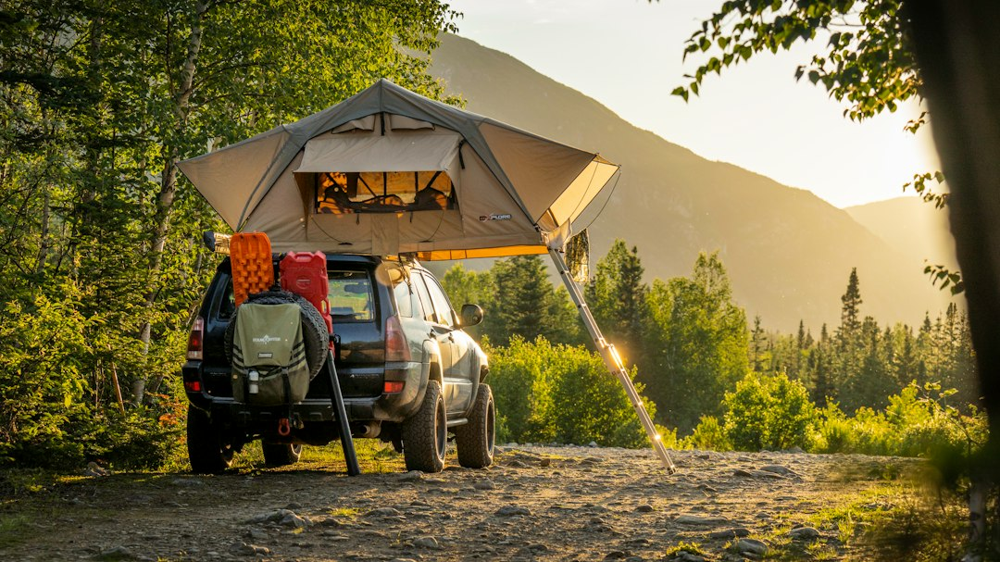

*This post contains affiliate links. As an Amazon Associate, I earn from qualifying purchases at no extra cost to you.*

Day four of a dusty trail loop is when a hot shower stops being a luxury and starts being a morale decision. Most budget builds skip it because a dedicated shower system sounds like a four-figure upgrade. It is not. A workable setup costs less than a decent set of recovery straps, and the real challenge is matching the system to how you travel, not spending more.

My position is simple: for most budget overlanders, a battery-powered pump shower paired with a bucket or jug is the best starting point, and a propane tankless heater is the best upgrade if you shower daily in cold weather. Electric immersion heaters sound convenient, but they demand more power than most budget electrical systems can supply. Fuel, power, and water are the three limited resources on a remote trip, and every shower design spends all three. The goal is to spend them deliberately.

This guide walks through the shower designs, the heating options, a quick way to size your setup, and the mistakes that waste water and fuel.

Photo by <a href="https://unsplash.com/@wap_des_bois?utm_source=artlines_blog&utm_medium=referral">Alfred Boivin</a> on <a href="https://unsplash.com/?utm_source=artlines_blog&utm_medium=referral">Unsplash</a>

## Portable Camp Showers: Three Designs Worth Considering

Portable camp showers fall into three practical categories, and the category matters more than the brand. Each one trades simplicity against pressure, cost, and the amount of gear you need to carry.

### Gravity and solar bags

The oldest design is a black bag you fill, hang from a rack or tree branch, and let the sun warm. It costs very little, has nothing to break, and uses no electricity. The tradeoff is that it depends on weather and daylight. In shoulder seasons, at high elevation, or under forest canopy, the water may never get warm enough to be pleasant. Pressure comes only from height, so you need a high anchor point, and rinsing hair takes patience. If you camp mostly in sunny, dry climates and shower in the afternoon, this is a defensible budget pick. For everyone else it is a backup.

### Battery-powered pump showers

This is the category I recommend first. A submersible or inline pump runs from a rechargeable battery, pulls water from a bucket, jug, or collapsible container, and delivers a real spray through a handheld head. Pressure is steady, you control the flow, and you can shower standing next to the vehicle without hanging anything. Many of these units charge over USB, which means your existing power bank, vehicle USB port, or small solar panel can top them up.

The [Portable Camping Shower with a 6000mAh battery, LED display, and 5 gallon collapsible bucket](https://www.amazon.com/dp/B0DNLXG8Y5?tag=budgetoverlander-20) is a good example of this approach. The listing describes three spray modes and a bundled collapsible bucket, which keeps the whole kit compact. A 5 gallon bucket weighs about 42 pounds when full, since water runs roughly 8.3 pounds per gallon. That is worth remembering when you check your payload, a topic covered in our guide on [how to determine payload capacity and safe weight limits for your vehicle](/2026/09/19/how-to-determine-payload-capacity-and-safe-weight-limits-for-your-vehicle/).

The main limitation is that a pump shower moves water but does not heat it. You still need a heating plan, which is the focus of the next section.

### Pressurized and plumbed systems

At the top of the range are pressurized tanks, roof-mounted tubes, and plumbed systems with an onboard water tank. They deliver the best experience, but they cost more, add weight high on the vehicle, and introduce plumbing that can leak or freeze. For a budget build, they make sense only after you have proven you shower often enough to justify the investment. Start with a pump shower and upgrade later if you find yourself using it constantly.

## Hot Water Heating Systems for Remote Overlanding

Cold water is fine in July and miserable in October. Heating is where the cost, fuel, and safety questions get serious, so it deserves the most careful decision.

> **Safety warning:** Propane appliances and electric heaters carry real risks. Never run a propane water heater inside a vehicle, tent, rooftop tent, awning enclosure, or any enclosed space, because combustion produces carbon monoxide. Keep it outdoors with open air on every side, check hoses and fittings for leaks with soapy water, and carry a working carbon monoxide detector in your sleeping area. The [U.S. Consumer Product Safety Commission](https://www.cpsc.gov/Safety-Education/Safety-Education-Centers/Carbon-Monoxide-Information-Center) publishes clear guidance on carbon monoxide hazards. If you smell gas or suspect a leak, shut off the tank and move away. For permanent installations, have a qualified professional do the work.

### Stove-heated water

The cheapest method uses gear you already own. Heat a pot or kettle on your camp stove, then blend it with cold water in the shower bucket. This costs nothing extra and offers precise temperature control, but it is slow and burns fuel you may need for cooking. If you already carry a good stove setup, our comparison of [portable camp stoves and cooking systems for overlanders](/2026/10/24/best-portable-camp-stoves-and-cooking-systems-for-overlanders-compared/) covers fuel use in detail. Expect to heat several pots for one real shower, which is why this method works best for quick rinses.

### Propane tankless heaters

A portable propane tankless heater heats water on demand as it flows through, so you are not waiting for a bucket to warm. The [CAMPLUX 5L Portable Tankless Water Heater](https://www.amazon.com/dp/B01CJPU6JI?tag=budgetoverlander-20) is listed at 1.32 gallons per minute, with overheat protection, low pressure startup, and a folding handle. That flow rating is the useful number. At roughly 1.3 gallons per minute, a focused three to four minute shower with the water shut off while soaping uses about four to five gallons.

The tradeoff is the hardware around it. These units generally need a propane supply, a water source capable of feeding them, and a pump or elevated container to push water through. Check the manufacturer documentation for the exact minimum water pressure, the battery or ignition requirements, and the recommended hose and regulator. Verify those details on the current listing before you buy, since models and specifications change.

Propane is also the most fuel-efficient way to add large amounts of heat. Raising a pound of water by one degree Fahrenheit takes about one BTU, so warming 5 gallons from 55 to 100 degrees takes roughly 1,900 BTU in perfect conditions. Real-world losses raise that figure, but it shows why a small amount of propane goes a long way.

### Electric immersion heaters

An immersion heater drops into a container and warms it directly. The [Camping Shower with Heater, food-grade water jug, 6000mAh pump, and 1500W immersion heater with auto shut-off](https://www.amazon.com/dp/B0H6K5356F?tag=budgetoverlander-20) bundles the pump, the jug, and the heater in one kit. The auto shut-off is a meaningful safety feature, since an immersion element running dry can damage itself or create a hazard.

The catch is power. A 1500 watt element pulls about 125 amps from a 12 volt system, and more once inverter losses are included. That is far beyond what most budget dual battery setups can deliver comfortably, and it would drain a typical battery quickly. Realistically, you run a heater like this from shore power, a generator, or a large power station, not from a small auxiliary battery. If you are planning your electrical system, read our guides on [solar power for vehicles](/2026/09/22/solar-power-for-vehicles-basics-and-budget-charging-solutions/) and a [DIY dual battery setup for overlanders under 300 dollars](/2026/09/12/diy-dual-battery-setup-for-overlanders-under-300-dollars/) before assuming you can run a high-wattage heater in the field. Check the listing for the heater's actual input requirements and plug type, because the 6000mAh figure refers to the pump, not the heater.

### Solar and passive heating

Black containers on a roof rack will absorb heat during a sunny drive and often arrive at camp lukewarm. This is free, and it pairs well with a small boost from the stove. It works best as a supplement rather than a plan, since cloud cover, cold nights, and shaded campsites can undo it.

## Sizing Your Portable Camp Showers: Water and Power Math

Before you buy anything, run a short decision process. It takes ten minutes and prevents most bad purchases.

1. **Count your showers.** Decide how many showers per trip and how many people. A two person, five day trip with a shower every other day is about three showers, not ten.
2. **Set a water budget per shower.** Five gallons is generous. A wet, soap-off, rinse technique with the pump switched off in between can work in two to three gallons. Multiply by the number of showers and compare that to the water you already carry for drinking and cooking.
3. **Check the weight.** Multiply gallons by 8.3 pounds and compare the total to your remaining payload and where the weight sits in the vehicle.
4. **Pick your heat source by climate.** Warm weather means solar or stove-heated water is probably enough. Cool or cold weather points toward a propane tankless heater.
5. **Check your power source.** A USB-charged pump needs only a few watt-hours per shower. A 1500 watt immersion heater needs shore power or a generator-class supply.
6. **Plan the logistics.** Decide where you will shower, how you will contain the water, and how you will refill. A pump shower needs a source, and a [portable water filter and storage system](/2026/09/17/best-portable-water-filters-and-storage-systems-for-remote-overlanding/) lets you refill from streams when your tanks run low.

The main tradeoff you will find is that every step that adds comfort adds either weight, power draw, or fuel. The cheapest sensible build for most people is a pump shower, a bucket, and stove-heated water. Add the propane heater only when you find the stove method too slow or too fuel hungry.

### Where and how to shower

Leave No Trace guidance asks you to wash well away from water sources. The [Leave No Trace Center for Outdoor Ethics](https://lnt.org/why/7-principles/dispose-of-waste-properly/) recommends using biodegradable soap sparingly, staying roughly 200 feet from streams and lakes, and scattering strained greywater. Even biodegradable soap should never go directly into a water source. On public land, check local regulations as well, since some areas restrict washing near water or require specific practices.

## The Three Supplied Picks Compared

Here is how the three products in this guide stack up. Specifications come from the product listings, so confirm current details before you order.

| Feature | CAMPLUX 5L Tankless Heater | 6000mAh Pump Shower with Bucket | Shower with 1500W Immersion Heater |
|---|---|---|---|
| Main job | Heats water on demand | Pumps water, no heat | Pumps and heats water |
| Energy source | Propane | Rechargeable battery | Battery for pump, high-wattage power for heater |
| Listed highlight | 1.32 GPM, overheat protection | 3 spray modes, 5 gallon collapsible bucket | Auto shut-off heater, food-grade jug |
| Best climate | Cool to cold | Warm to mild | Any, if power is available |
| Main drawback | Needs propane and a water feed | No heating | Heater needs far more power than a small battery gives |
| Best for | Frequent showers in cold weather | First shower setup on a budget | Trips with generator or shore power |

For most readers I would start with the pump shower, since it solves the pressure problem cheaply and works with any heating method. Add the propane heater when cold weather becomes your main obstacle. Choose the immersion kit only if you reliably have a generator, power station, or campground hookup, because without that supply the heater is dead weight. All three are candidates awaiting careful review of the current listing details, so read recent reviews for reports of leaks, battery life, and cold-weather performance before buying.

If you are weighing the whole camp setup, a [camp kitchen for under 200 dollars](/2026/06/10/how-to-set-up-a-camp-kitchen-in-your-vehicle-for-under-200/) shares many of the same water and fuel planning questions.

## Common Mistakes and Problems to Avoid

Most shower problems come from underestimating water, power, or cold. These are the ones that matter most.

**Overbuying heat.** A 1500 watt heater looks like a bargain until you realize your battery cannot run it. Match the heater to the power you can actually supply, not the one on the box.

**Ignoring ventilation.** Running any propane device near a tent wall, under an awning with walls attached, or inside a vehicle risks carbon monoxide buildup. Keep it in open air, downwind from where you sleep, and never leave it unattended.

**Skipping a leak check.** Propane connections can loosen in transit on rough trails. Brush soapy water on fittings and watch for bubbles every time you connect a tank.

**Letting the pump run dry.** Many small pumps overheat or wear quickly without water. Keep the intake submerged and switch off the moment the bucket runs low.

**Forgetting the cold start.** Batteries lose capacity in cold weather. If your pump battery is sluggish on a frosty morning, warm it inside your jacket or sleeping area before use.

**Using too much water.** Leaving the spray running while you lather is the fastest way to empty a container. Wet, shut off, soap, then rinse.

**Freezing hoses and heaters.** In below-freezing conditions, water left in a heater or hose can freeze and crack components. Drain everything after use and store gear where it stays above freezing.

**Washing too close to water.** Dumping soapy water near streams harms aquatic life and can bring fines on public land. Move well away and scatter strained water over a wide area.

**Neglecting hygiene in stored water.** Water left sitting warm in a container can grow bacteria. The [CDC](https://www.cdc.gov/legionella/) notes that warm, stagnant water can support Legionella growth, so drain and dry your containers between trips and use fresh water.

## FAQ

### How much water do I need for a camp shower?

Plan on two to three gallons per person if you use a pump with a wet, soap, rinse routine, and up to five gallons for a relaxed shower with longer hair or heavy dust. A propane tankless heater rated near 1.3 gallons per minute will use about four gallons for a three minute shower if you leave the water running throughout. The best approach is to shut off the flow while you soap, which can cut usage nearly in half. Multiply by the number of showers and people, then compare it to your drinking and cooking supply, since you should never shower with water you may need to drink.

### Can I run an electric immersion heater from my vehicle battery?

Generally not from a small auxiliary battery. A 1500 watt element draws roughly 125 amps from a 12 volt supply before inverter losses, which would rapidly drain a typical budget dual battery system and could overload wiring and fuses that were not designed for the load. Heaters of this size are better suited to campground hookups, a generator, or a large portable power station with a high-output inverter. Check the product listing for the heater's exact power input and plug type. If your electrical system is modest, a propane heater or stove-heated water is the safer and more practical way to get hot water.

### Is a propane water heater safe to use at camp?

It can be, if you follow the manufacturer instructions and treat carbon monoxide seriously. Use the heater outdoors only, with open air on all sides, never inside a vehicle, tent, or enclosed awning. Inspect hoses and fittings for leaks, keep flammable materials away, and run a battery-powered carbon monoxide detector in your sleeping area. Features like overheat protection add a layer of safety but do not replace good practice. Never leave the heater running unattended, and shut off the propane supply when you are finished. If you notice a gas smell or damaged parts, stop using it and have it inspected.

## Conclusion

The right shower setup is the one that matches your climate, your power supply, and your payload. For most budget overlanders, that means a pump shower and a bucket first, heated with stove water, then a propane tankless heater once cold weather becomes the real obstacle. Reserve high-wattage electric heating for trips where you have a generator, power station, or hookup.

Your next step is simple: write down how many showers you want per trip, how many gallons you can spare, and what power you can actually supply. Those three numbers will tell you which of the three options above makes sense, and which ones you can safely skip.

If you found this useful, bookmark the page or leave a comment with the shower setup you are planning.

## Related reading

- [Best Portable Water Filters And Storage Systems For Remote Overlanding](/2026/09/17/best-portable-water-filters-and-storage-systems-for-remote-overlanding/)
- [Solar Power For Vehicles Basics And Budget Charging Solutions](/2026/09/22/solar-power-for-vehicles-basics-and-budget-charging-solutions/)

  
<strong>About the Author</strong>

  
The Budget Overlander team researches trail-ready vehicle builds with an eye on cost and practicality. Our guides draw from forum-documented builds, manufacturer specs, and owner reviews - so you know what to expect before you buy.

