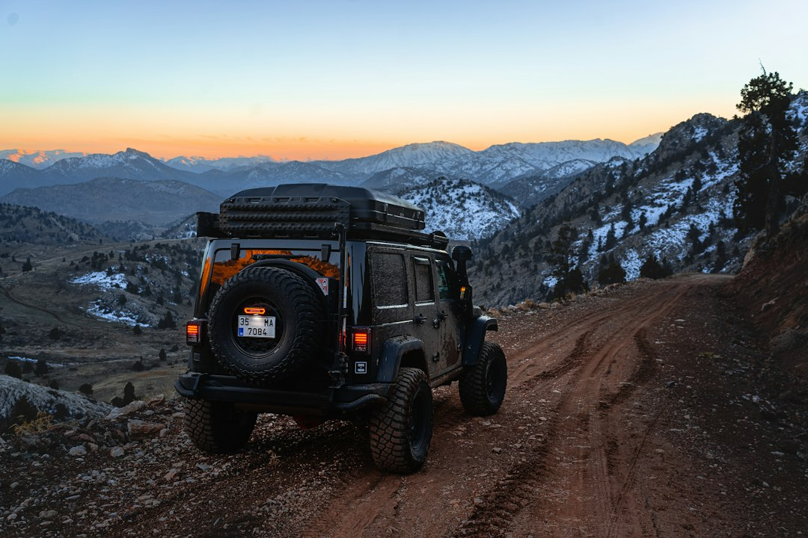

*This post contains affiliate links. As an Amazon Associate, I earn from qualifying purchases at no extra cost to you.*

A flat tire is the most common way a cheap, well-planned trip turns into an expensive one. Sharp shale, cactus spines, wire from old fence lines, and a single stick driven in at the wrong angle can all end your day twenty miles from pavement. The usual response is to buy one product and call the problem solved. A bottle of sealant, a bag of plugs, or a second spare each fix part of it, and none of them covers everything.

Here is the position this guide takes: the best budget setup is layered. Sealant reduces how often small punctures become roadside repairs. A plug kit and a way to inflate fix the ones that get through. A good spare and the knowledge to swap it handle what neither can fix, like a torn sidewall. You do not need to spend much on any single layer, but skipping a layer is where trips go wrong.

Below you will find what sealant does well and badly, how to think about plug tools (including a very compact one that is easy to misuse), a side-by-side comparison, a step-by-step trailside plug repair, and the mistakes that turn a ten-minute fix into a tow.

Photo by <a href="https://unsplash.com/@tents_and_tread?utm_source=artlines_blog&utm_medium=referral">Thomas Tucker</a> on <a href="https://unsplash.com/?utm_source=artlines_blog&utm_medium=referral">Unsplash</a>

## Why Budget Tire Repair Kits Fail on the Trail

Most failures are not about the tools. They come from a mismatch between the kit and the problem. A kit built for a bicycle will not seat a plug in a 33-inch truck tire. A repair kit with no way to reinflate is just a bag of tools you cannot use. A plug kit with no jack, wheel chock, or gloves leaves you doing a repair on a slope with bare hands.

Start by naming the three kinds of tire trouble you will realistically face:

**Slow leaks from small punctures.** Thorns, nails, and screws leave a hole that seeps air. These are the best candidates for both sealant and plugs.

**Fast leaks from larger tread injuries.** A sharp rock or a stick can leave a hole that sealant will not hold. A plug is the realistic fix, and sometimes a plug is only a ride-out solution.

**Unrepairable damage.** Sidewall cuts, bulges, and bead damage are not plug territory. Industry guidance, including the tire manufacturer trade group [USTMA](https://www.ustires.org), points toward limiting repairs to the tread area, and many shops will not repair a puncture larger than roughly a quarter inch. A trailside plug in a sidewall is a gamble, not a repair.

That third category is why a kit is never the whole answer. Any budget plan should include a healthy spare, which is the reason tire carriers and spare placement matter. If you are still deciding where the spare lives, the [rear bumper tire carrier install guide](/2026/07/30/install-rear-bumper-integrated-tire-carrier-budget/) covers the mounting side of that decision.

Another recurring failure is tire pressure. [NHTSA tire safety guidance](https://www.nhtsa.gov/vehicle-safety/tires) stresses regular pressure checks because underinflation is a leading contributor to tire damage. On the trail, airing down for traction makes tires more vulnerable to pinch cuts and sidewall damage, which means the kit you carry should match how you actually drive, not how you drive on the highway.

Finally, be honest about your terrain. A Forest Service road with occasional gravel is a different risk profile than a rocky desert wash. Rock and cactus country argues for stronger prevention and a bigger kit. Packed dirt and sand argue for a lighter one. Decide that first, then buy.

## Puncture Prevention Kits: What Sealant Can and Cannot Do

Puncture prevention in the budget world mostly means liquid sealant, with tire choice and sensible pressure as the free half of the plan. Sealant works by sitting inside the tire and plugging small holes as they form, so many small punctures never become flats.

A candidate worth knowing is the [Slime 10207 2-in-1 Tire & Tube Sealant](https://www.amazon.com/dp/B08TFMBKZ2?tag=budgetoverlander-20), which is sold in a one-gallon jug and marketed for off-highway tires and tubes. The listing describes it as non-toxic and eco-friendly, and as a product that both repairs and prevents. The gallon size is the practical point for overlanders: it is a larger quantity than a small bottle.

### Where sealant earns its place

- **Slow seepers.** Thorns and small nails are where sealant shines, since the hole is small and the leak is gradual.
- **Trailers and spares.** Tires that sit for months and are rarely checked benefit from something that quietly handles small leaks.
- **Multi-vehicle households.** One jug can serve a truck spare, a utility trailer, a wheelbarrow, and bicycles, which stretches the budget.

### Where sealant falls short

Sealant is not a cure for large cuts. A side impact, a tear, or a gash from a sharp rock will outrun any liquid. It also dries out over time, so treated tires should be checked and topped up according to the manufacturer's guidance. Sealant can complicate later repairs, because a shop may have to clean the inside of the tire before patching it. And some sealants can interfere with sensors or valve components, so tire pressure monitoring system (TPMS) sensors deserve a look at the label and the product's compatibility notes before you pour anything in.

Two practical cautions follow. First, read the label for the maximum puncture size, the dosing by tire size, and any vehicle or speed limits. A product marketed for off-highway use is not automatically right for a daily-driven truck on the interstate. Second, treat sealant as an addition to a plug kit, not a replacement. A tire that has lost its sealant, or a hole too big to seal, still needs a hands-on fix.

For most budget builds, the sensible use is on spares and trailer tires first, then on the main set only if you are comfortable with the TPMS and cleanup tradeoffs.

## Plug Kits and Tools: Where the Dynaplug Racer Pro Fits

Plug tools are the other half of the equation. They fix an existing hole by pushing a rubberized plug into the puncture from the outside, which takes minutes and requires no wheel removal. That speed is why they are the standard trailside answer.

The [Dynaplug Racer Pro Bicycle Tire Repair Tool](https://www.amazon.com/dp/B08YWPHW2C?tag=budgetoverlander-20) is marketed as a bicycle tire repair tool. Check Dynaplug's manufacturer site at [dynaplug.com](https://www.dynaplug.com) for the broader range and for tools intended for other vehicles.

That distinction matters. The Racer Pro is the right size for a bicycle tire, and a bicycle-scale tool is not what you want for a light truck tire. A 33-inch truck tire has thicker rubber, higher loads, and bigger holes, and a plug tool needs to be sized to match. If you ride a bike on the back of your rig, the Racer Pro is a sensible, light addition to the bike's own kit. If your goal is fixing the truck, look at the vehicle-sized tools in the same family or a conventional reamer-and-insertion-tool kit with string plugs.

### How to think about the two plug styles

**Pre-loaded plug tools.** These carry the plug in the tool and push it in with one motion. They are faster, cleaner, and easier to use with cold or dirty hands. They tend to cost more per kit, and replacement plugs add up.

**Reamer and string plug kits.** These are the classic budget choice. You ream the hole, thread a sticky plug through the insertion tool, push it in, and trim it. They are cheap, widely available, and effective, but they take a little practice and more hand strength.

Neither style is a permanent repair by industry standards. The conservative approach is to treat a trailside plug as a way to get home, then have the tire properly inspected or patched from the inside by a shop. That advice comes from the same tire repair guidance mentioned earlier, and it protects you from the quiet failure of a plug that was never meant to be forever.

If you also carry a compressor, which you should, the [best air compressors under $100 for 31 to 33 inch tires](/2026/08/06/best-air-compressors-under-100-for-31-33-inch-tires/) comparison is a good companion read, because a repair you cannot reinflate is just a delay.

## Budget Tire Repair Kits Compared

Here is how the main options stack up for trail use. The products linked are the two covered above; the generic categories are included so you can see the whole picture.

| Option | Best for | Strengths | Limits | Budget feel |
|---|---|---|---|---|
| [Slime 10207 2-in-1 sealant, 1 gallon](https://www.amazon.com/dp/B08TFMBKZ2?tag=budgetoverlander-20) | Prevention and repair on off-highway tires and tubes | One-gallon jug, marketed to prevent and repair | A sealant, not a plug; check it suits your tires | Gallon jug |
| [Dynaplug Racer Pro](https://www.amazon.com/dp/B08YWPHW2C?tag=budgetoverlander-20) | Bicycle tire repair | Bicycle-specific repair tool | Sold as a bicycle tool; check manufacturer guidance for other vehicles | Bike-focused |
| Generic reamer and string plug kit | Truck and SUV tread punctures | Cheap, repeatable, widely sold | Takes practice, needs some hand strength | Lowest cost |
| Vehicle-sized pre-loaded plug tool | Truck tread punctures when speed matters | Fast and clean to use | Higher cost, replacement plugs add up | Moderate |
| Full-size spare | Sidewall damage, big cuts | Only real fix for unrepairable damage | Takes space and weight | Highest upfront |

### A simple decision framework

Use these questions in order:

1. **Do you have a healthy full-size spare?** If not, buy or build that first. No plug or sealant replaces it for sidewall damage.
2. **Can you inflate a tire on the trail?** If not, buy a compressor before a plug kit.
3. **What is your most likely puncture?** Thorns and nails point to sealant plus plugs. Sharp rock and sidewall risk point toward better tires and a spare.
4. **Do you tow a trailer or carry a bike?** Add sealant for the trailer and a bike-sized tool for the bike.
5. **What can you afford to do twice?** Start with a cheap plug kit and add the pre-loaded tool later if you find yourself fumbling.

For most beginners on a tight budget, the answer is a conventional plug kit, a compressor, and a sealed spare. Add the sealant jug as the prevention layer, and add the Racer Pro only if a bike is part of the setup.

Tire choice belongs in this conversation too, since a tougher tire reduces punctures before any kit comes into play. If you are shopping, the [best budget all-terrain tires under $150 per tire for 33 inch](/2026/10/03/best-budget-all-terrain-tires-under-150-per-tire-for-33-inch/) guide covers value-focused options.

## How to Plug a Tubeless Tire on the Trail

Safety comes first. Tire work involves a loaded vehicle, a jack, and compressed air. Park on level, firm ground, set the parking brake, chock the wheels, and never put any part of your body under a vehicle held only by a jack. Wear gloves and eye protection, since wire and debris can be sharp. If the damage is in the sidewall, the tire is bulging, or you are unsure, change to the spare and call a professional rather than relying on a plug.

Here is the process for a typical tread puncture:

1. **Find and mark the hole.** Listen for the hiss or spray soapy water on the tread to find bubbles. Mark the spot with a paint pen or a bit of chalk.
2. **Remove the object.** Pull the nail or thorn with pliers, noting the angle it went in, since you want to follow the same angle with your tool.
3. **Ream the hole.** Push the reaming tool in and out several times to clean and roughen the channel so the plug can bond. Skip this step only if your tool is designed for it.
4. **Load the plug.** Thread a sticky string plug through the insertion tool so it sits at the midpoint, or load the pre-filled plug as the tool's instructions direct.
5. **Insert firmly.** Push straight in with steady pressure until only a short length of plug remains outside the tire, then withdraw the tool with a quick pull.
6. **Trim and check.** Cut the plug close to the tread and spray the area with soapy water. No bubbles means the seal is holding.
7. **Reinflate and recheck.** Inflate to the correct pressure, then recheck after a few minutes. Plan to monitor pressure through the rest of the trip.

If you want a broader plan for what to do after the repair, the [guide to handling a breakdown on the trail](/2026/06/11/how-to-handle-a-breakdown-on-the-trail/) covers staying put, communicating, and deciding when to keep driving.

## Common Mistakes and Problems to Avoid

Most tire repair headaches repeat across trips. These are the ones worth designing around.

**Carrying a kit but not practicing.** A plug kit used for the first time on a dark trail is a recipe for stripped plugs and frustration. Practice on a scrap tire or on a spare in your driveway. It takes ten minutes and builds the hand feel you will need.

**Using the wrong size tool.** The Racer Pro is a bicycle tool, and it should stay with the bike. Matching the tool to the tire is the single most common budget mistake, and it is easy to avoid by reading the product description.

**Treating a plug as permanent.** A trailside plug is a way to get home. Have the tire inspected or properly repaired afterward, and replace it if the damage is near the shoulder or the injury is large.

**Skipping the compressor.** The best plug in the world does nothing without air. Pair every repair kit with a way to reinflate, and keep it in an accessible spot rather than buried under cargo.

**Over-trusting sealant.** Sealant helps with small holes and does nothing for a gash. Do not drive faster or farther on a sealed tire than you would on a plugged one, and check pressures often.

**Forgetting about TPMS and cleanup.** Some sealants complicate sensors and later repairs. Read the product notes before pouring a gallon into every tire, and consider starting with a spare or trailer tire as a trial.

**Airing down and forgetting to air up.** Low pressure improves traction and increases the risk of pinch damage. Keep a plan and a gauge, and air back up before you return to pavement.

**Working unsafely.** Jacking on soft ground, skipping wheel chocks, or leaning under a raised vehicle causes serious injuries. If conditions are poor, do the minimum to stabilize the vehicle and move to a safer spot.

**Ignoring the spare.** A flat spare is a secret second flat. Check its pressure and condition before each trip.

## FAQ

### Is tire sealant a good substitute for a plug kit?

No, they do different jobs. Sealant is a prevention layer that handles small, slow punctures before they become a roadside problem. A plug kit is a repair tool for holes that sealant cannot close. Sealant has a maximum puncture size listed on the label, and it does nothing for sidewall damage or tears. A plug kit also fails on large or sidewall injuries, but it covers more of the tread-area holes that sealant misses. The practical answer is to carry both, with the plug kit as the active repair and the sealant as a quiet backup.

### Can I use the Dynaplug Racer Pro on my truck tires?

It is marketed as a bicycle tire repair tool, so it is meant for bike tires and not for light truck tires. A truck tire has thicker rubber and larger holes, which call for a vehicle-sized tool. A conventional reamer and string plug kit is a cheaper alternative. Keep the Racer Pro with the bicycle if you carry one, and buy a vehicle-sized tool for the truck.

### Will tire sealant damage my TPMS sensors or complicate repairs?

It can. Some sealants coat the inside of the tire and can interfere with sensors or valve components, and shops may need to clean the tire before patching it. Read the product label and the manufacturer's compatibility notes before treating tires that carry TPMS sensors. If you are unsure, start with a spare or a trailer tire, where sensors are rarely a concern, and see how you like the product before treating the rest of the set. Ask your tire shop about cleanup fees too.

## Conclusion

The best budget setup is not one product, it is a small system. Use sealant such as the Slime gallon jug where prevention makes sense, carry a plug kit sized for your actual tires, keep a compressor within reach, and maintain a healthy spare for the damage nothing else can fix. Treat the Dynaplug Racer Pro as a bicycle tool unless you are buying for a bike.

Your next step is simple: check your spare's pressure this week, pick a plug kit that matches your tire size, and practice one repair in your driveway before the next trip. Ten minutes of practice will save you far more than any single piece of gear.

If this comparison helped, bookmark it for your next gear check and tell us in the comments what has kept your tires holding air.

**Related Reading:**
- [How To Handle A Breakdown On The Trail](/2026/06/11/how-to-handle-a-breakdown-on-the-trail/)
- [Best Budget Tire Brands And Sizes For Overlanding Different Terrains And Conditi](/2026/10/01/best-budget-tire-brands-and-sizes-for-overlanding-different-terrains-and-conditi/)

  
<strong>About the Author</strong>

  
The Budget Overlander team researches trail-ready vehicle builds with an eye on cost and practicality. Our guides draw from forum-documented builds, manufacturer specs, and owner reviews - so you know what to expect before you buy.

