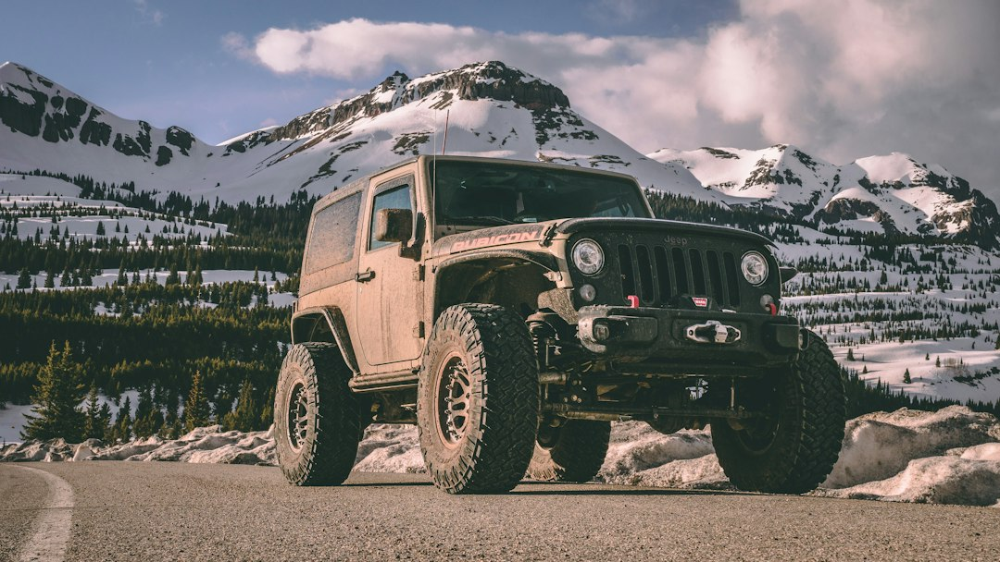

*This post contains affiliate links. As an Amazon Associate, I earn from qualifying purchases at no extra cost to you.*

Every budget overlander eventually asks the same question while staring at a muddy rut: should I pay a monthly fee so someone else pulls me out, or spend a few hundred dollars once and handle it myself? Both answers sound frugal, and both can quietly cost far more than expected.

Here is the position this article defends. For most budget builders, the best answer is neither pure option. A modest DIY kit built around a strap, shackles, and a lifting tool handles the majority of real-world stuck situations. A cheap roadside add-on or membership covers the situations a kit cannot, mainly breakdowns, flat-bed hauls, and stuck vehicles near maintained roads. Paying for insurance alone leaves you exposed once you leave pavement, and buying gear alone leaves you with no answer when the vehicle is broken rather than stuck.

The sections below put numbers on both paths, explain where coverage and equipment each fail, and give you a build order that spends money where it reduces risk the most.

Photo by <a href="https://unsplash.com/@codylannom?utm_source=artlines_blog&utm_medium=referral">cody lannom</a> on <a href="https://unsplash.com/?utm_source=artlines_blog&utm_medium=referral">Unsplash</a>

## What Recovery Insurance Covers and Where It Stops

"Recovery insurance" is an umbrella term, and the word matters less than the contract. Three products get lumped together: the roadside assistance add-on sold with an auto policy, a standalone roadside membership, and specialty off-road recovery plans. They differ sharply in what they will actually do when you are off pavement.

### Roadside add-ons and memberships

Roadside coverage attached to an auto policy is usually the cheapest option, often a modest annual charge, according to consumer guidance from the [Insurance Information Institute](https://www.iii.org/). Standalone memberships cost more per year but typically bring higher tow-distance limits and more service calls. Both are designed around a vehicle sitting on or beside a maintained road: dead battery, flat tire, lockout, fuel delivery, and tow to a shop.

The catch for overlanders is the winching clause. Many plans cover pulling a vehicle out of a ditch or mud only if it sits within a short distance of a public roadway, and some exclude unmaintained roads, trails, beaches, or private land entirely. Read the actual terms of service, not the marketing page. The two phrases to search for are "winching" and "off-road" or "unimproved road."

### Specialty off-road plans

Some regional and enthusiast-oriented plans advertise trail recovery. These can be worthwhile, but they often come with caps on payout, requirements to use approved operators, and coverage areas that do not include the remote spots where you most want help. Cell coverage is the quiet problem here. A plan that requires a phone call is worth little where you have no signal, which is why a [trail communication setup for solo overlanders](/2026/08/02/best-trail-communication-radios-solo-overlanders-compared/) belongs in the same budget conversation.

### What a professional recovery really costs

If you have no coverage and need a wrecker or a specialist with a heavy winch truck, the bill depends on distance, terrain, and the time of day. A few hundred dollars is common for an easy pull near a road, and costs can climb well past a thousand dollars for remote or technical situations. That unpredictability is the real argument for carrying coverage, even if you rarely use it.

## The True Cost of a DIY Recovery Kit

A recovery kit looks cheap until you count everything required to use it safely. The sticker price is only the entry fee.

### The core kit

A boxed kit is the simplest starting point. The [ARB RK9A Premium Recovery Kit for Any Offroad Adventure, The Most Complete 4x4 Recovery Equipment Bundled in a Full Color Box and Updated Recovery Bag and Damper](https://www.amazon.com/dp/B08ZVF7QW3?tag=budgetoverlander-20) bundles recovery equipment in one package with a recovery bag and damper. Check the current price and the exact contents on the product listing before you buy, because bundles get revised. Buying a bundle from a known recovery brand makes sense because the pieces are chosen to work together, and mismatched ratings are a classic source of failures.

The cost trap is that a strap needs two solid recovery points on the vehicle. If your truck has no frame-mounted recovery points, you may need to add them, and that can add real money. Tow hooks bolted to factory points are not the same as purpose-built recovery points, so confirm what your vehicle's manufacturer rates them for.

### The lifting tool

A strap does nothing when you are high-centered or have a wheel hanging in a hole. A high-lift style jack covers that gap. The [Hi-Lift Jack 48" All-Cast Jack HL-485](https://www.amazon.com/dp/B000688VNE?tag=budgetoverlander-20) is the familiar choice, and you should read the maker's lifting ratings and operating instructions before use. The jack is only as useful as your ability to lift from a stable point, so budget extra for a base plate and a way to grip your bumper or rock sliders. Used badly, these jacks are also among the more dangerous tools in an overland kit.

### A note on the winch listing

One of the supplied listings, the RC4WD 1/10 Mini Warn winch, is a scale accessory for radio-controlled crawler models, not a working winch for a real truck. It will not pull a vehicle, and it should not appear on your recovery budget. If you want a real winch, plan on a rated unit sized for your vehicle's weight, and use the walkthrough on [installing a winch on a budget](/2026/07/26/how-to-install-winch-budget-diy/) for mounting and wiring costs, which often exceed the winch's own price.

### Hidden costs that change the math

- Training time, because a kit you have never practiced with is slow and risky.
- Replacement of worn straps, which degrade from UV, abrasion, and shock loading.
- Storage space and weight, which cut into your payload.
- Add-ons such as a tree-trunk protector, extra shackles, traction boards, and a shovel.

## Safety First: Recovery Gear Stores Energy

Recovery work involves high tension, heavy parts, and lifting a vehicle on a mechanical jack. Do not treat it as a casual task.

- Never stand in line with a strap or cable under load. If a component fails, it can snap back with lethal force.
- Use only rated shackles and recovery points, never a ball hitch or bumper not designed for it.
- A damper or heavy blanket over a loaded line reduces, but does not eliminate, snapback risk.
- A high-lift jack can kick sideways under load. Keep your body out of the handle's swing arc and never use the jack to support a vehicle while you work underneath it.
- If you are unsure, stop and call for help.

For more on the stakes of a winch setup, [synthetic versus steel winch rope](/2026/09/01/synthetic-vs-steel-winch-rope-cost-safety-and-replacement-intervals/) covers failure behavior and replacement intervals.

## Recovery Insurance vs DIY Recovery Kit: A Three-Year Cost Comparison

The table below uses illustrative ranges, not quotes. Prices vary by region, insurer, and gear brand, so treat these as a planning framework and replace the numbers with your own.

| Cost item (3 years) | Insurance only | DIY kit only | Hybrid |
|---|---|---|---|
| Roadside add-on or membership | $30 to $450 | $0 | $30 to $150 |
| Soft-recovery kit | $0 | $150 to $400 | $150 to $400 |
| Lifting tool and base plate | $0 | $100 to $200 | $100 to $200 |
| Replacement straps and wear items | $0 | $40 to $120 | $40 to $120 |
| One professional recovery (if needed) | $0 to $150 | $400 to $1,500 | $0 to $200 |
| Rough 3-year total | $30 to $600 | $690 to $2,220 | $320 to $1,070 |

### How to read this table

The insurance-only column looks cheapest, and for a driver who stays on forest roads and graded gravel, it may be. The weak point is the coverage that is not there. If your plan excludes winching beyond a short distance from a public road, your realistic cost on a bad day shifts to the "one professional recovery" row at full price.

The DIY-only column looks expensive because it includes a worst-case wrecker bill. That is deliberate. Gear does not help when the problem is a broken axle, a dead drivetrain, or a snapped part. In those cases, you still need a tow.

The hybrid column is where most budget builders land. It costs more than insurance alone but caps the downside on both sides, which is the real value of any safety spending.

## Where Each Option Fails

Neither path is complete, and being honest about the gaps keeps you from over-trusting either one.

### When insurance fails you

Insurance fails when you cannot reach the provider, when the terms exclude your location, or when the operator will not drive to where you are. It also fails when the issue is technical terrain that a standard tow operator is not equipped for. If you travel remotely, a satellite communicator or radio plan matters as much as the policy itself.

### When a DIY kit fails you

A kit fails when it cannot solve the problem in front of you. A strap needs a second vehicle. A jack needs firm ground and a lift point. Traction boards need a clear path. A solo traveler with a strap alone is stuck with a stuck truck, which is why the choice between [recovery boards, a winch, or a come-along](/2026/09/20/recovery-boards-vs-winch-vs-come-along-what-budget-travelers-actually-need/) matters so much for people who travel without a partner. A kit also fails when the owner lacks the skill to use it safely.

## How to Build a Budget Recovery Setup in Order

Spend in sequence so each dollar closes the largest remaining gap.

1. **Confirm your coverage terms.** Read your current roadside plan for winching limits, tow distance caps, and off-road exclusions. Call and ask directly whether an unmaintained forest road counts. Write down the answer.
2. **Verify your recovery points.** Inspect the front and rear of your vehicle for frame-mounted, rated recovery points. If you have none, plan the fix before you buy any strap, because the strap is useless without an anchor.
3. **Buy a matched soft-recovery kit.** A boxed option such as the ARB RK9A bundles recovery gear in one package. Check the ratings of each piece, match them to your vehicle's weight with a safety margin, and follow the manufacturer's guidance on use.
4. **Add traction and digging tools.** [Recovery boards](https://www.amazon.com/dp/B08CXS1721?tag=budgetoverlander-20) and a shovel solve a large share of mud and sand situations for less money than a winch.
5. **Add a lifting tool if your terrain needs one.** A high-lift jack is worth it for rocky or rutted trails. Buy a base plate and learn the technique before you ever need it.
6. **Practice in a low-stakes setting.** Rig a strap on flat ground, pull a vehicle a few feet, and learn the commands you will use with a partner.
7. **Consider a winch last.** A winch is the most expensive piece. Budget for mounting hardware and wiring, and see the guide on [budget winch accessories and recovery kit add-ons](/2026/08/18/best-budget-winch-accessories-and-recovery-kit-add-ons-essentials-compared/) for the extras that make it usable.

## Common Mistakes When Comparing Recovery Insurance vs DIY Recovery Kit Costs

Most bad decisions here come from comparing the wrong numbers.

**Comparing premiums to gear prices.** A small monthly fee looks tiny next to a few hundred dollars of gear. But the fee buys a different service. Compare what each option does on your worst realistic day, not the sticker price.

**Assuming "roadside" means "recovery."** A policy that covers towing from pavement may refuse a stuck vehicle on a trail. Ask for the exclusions in writing.

**Buying mismatched or unrated parts.** A bargain strap paired with an unrated shackle is a weak link, and the whole system is only as strong as its weakest piece. Check working load limits on every component.

**Ignoring recovery points.** Hooking a strap to an axle, a suspension arm, or a bolt-on hook not designed for shock loads can cause serious damage or injury.

**Skipping practice.** Learning to rig a pull while your truck is buried is the worst time to learn. Practice early, in good conditions, with a partner.

**Neglecting the gear after purchase.** Straps degrade in sunlight and when frayed. Inspect them before every trip and replace damaged ones. Gear that has been shock loaded or cut should be retired.

**Forgetting the tow-only scenarios.** A kit cannot fix a broken axle or a seized engine. Keep a breakdown plan in the budget, even if it is only a membership.

**Underestimating the cost of the gap.** One avoidable professional recovery can erase several years of savings from skipping insurance.

Land use rules also matter. Organizations such as [Tread Lightly](https://www.treadlightly.org/) publish guidance on responsible recovery and trail use, including avoiding damage to trees and soil when anchoring a pull.

## FAQ

**Does roadside assistance cover off-road recovery?**

Often not in the way overlanders assume. Many roadside plans cover winching only when the vehicle is near a public, maintained road, and some exclude trails, beaches, private land, or unimproved roads altogether. Terms differ by provider and by plan level, so the only reliable answer comes from the contract itself. Call your provider, describe your typical terrain, and ask them to confirm in writing whether your situation qualifies. If the answer is vague, assume you are not covered and plan accordingly. A cheap plan is still valuable for flat tires, dead batteries, and tows from pavement.

**Is a recovery kit worth it if I mostly stay on easy trails?**

Usually yes, but a small one. Even easy forest roads can turn muddy after rain, and a strap, rated shackles, and gloves cost far less than a single professional pull. You do not need a full kit for graded gravel. A matched soft-recovery set, a shovel, and [traction boards](https://www.amazon.com/dp/B08CXS1721?tag=budgetoverlander-20) cover most easy-trail problems. Add a communication method and keep your roadside plan active. If you travel alone, boards matter more than a strap because a strap needs a second vehicle to pull you out.

**Can I rely on a high-lift jack as my only recovery tool?**

It is risky to treat it that way. A high-lift jack can lift a vehicle and sometimes help in a stuck situation, but it solves only some problems and requires proper technique. The manufacturer's instructions stress stable footing, correct lift points, and keeping your body clear of the handle. It cannot pull a vehicle out of deep mud or sand. Pair it with a strap, traction boards, and a shovel, and learn its risks before using it on a trail. Never work under a vehicle supported only by a jack.

**How do I decide between insurance and gear if I can only afford one?**

Start with the plan that protects against your most likely and most expensive problem. If you travel on pavement and graded roads, a roadside plan with a decent tow allowance gives the broadest protection per dollar. If you travel on rougher trails with a partner, a basic matched kit plus a cheap roadside plan is a stronger pairing. Buy coverage first when money is very tight, then add gear in the order outlined above. Revisit the choice every year as your terrain and vehicle change.

The cheapest-looking option is rarely the cheapest outcome. Insurance alone leaves gaps once you leave maintained roads, and a kit alone leaves you without help when the problem is mechanical. A hybrid, built in the right order, usually delivers the best protection per dollar.

Your next action is concrete: read your roadside plan's off-road and winching terms today, and write down what it does and does not cover. Then check your vehicle for rated recovery points. Those two steps cost nothing, and they tell you exactly how much gear you actually need to buy.

If this breakdown helped, bookmark it for your next gear budget review and drop a comment with the terrain you drive most.

**Related reading**

- [Recovery Boards Vs Winch Vs Come Along: What Budget Travelers Actually Need](/2026/09/20/recovery-boards-vs-winch-vs-come-along-what-budget-travelers-actually-need/)
- [Best Budget Winch Accessories And Recovery Kit Add Ons Essentials Compared](/2026/08/18/best-budget-winch-accessories-and-recovery-kit-add-ons-essentials-compared/)

  
<strong>About the Author</strong>

  
The Budget Overlander team researches trail-ready vehicle builds with an eye on cost and practicality. Our guides draw from forum-documented builds, manufacturer specs, and owner reviews - so you know what to expect before you buy.

