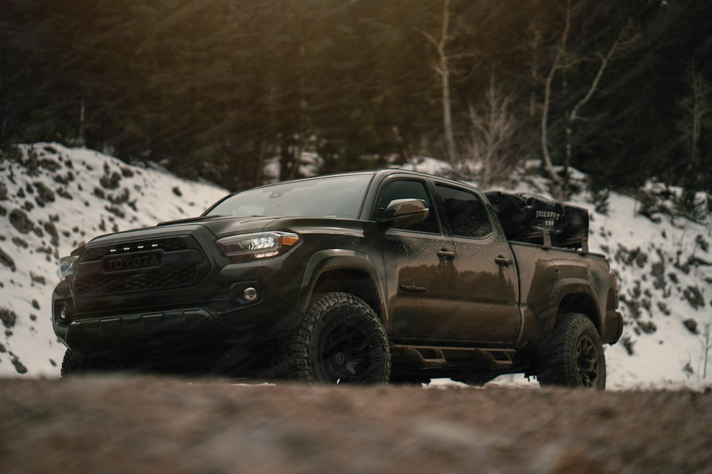

*This post contains affiliate links. As an Amazon Associate, I earn from qualifying purchases at no extra cost to you.*

Most cold-weather trips do not fail because of snow. They fail because of a battery that quit at 5 AM, a fuel filter clogged with wax, or a cabin so damp that everything you own turned to ice by morning. The small, boring systems are the ones that strand you.

My position: on a budget, spend your winter money in this order. Starting reliability first (battery, fluids, fuel), then a safe heat source, then traction, and only then comfort extras. An expensive heater on a vehicle with a tired battery is an expensive way to sit in the cold.

This guide covers every system that matters and where cutting corners costs more later. You do not need a six-figure expedition truck to camp at 0°F. You need a methodical routine and a few well-chosen parts.

Photo by [Clint McKoy](https://unsplash.com/@clintmckoy?utm_source=artlines_blog&utm_medium=referral) on [Unsplash](https://unsplash.com/?utm_source=artlines_blog&utm_medium=referral)

**Why Vehicle Winterization for Overlanding in Cold Climates Is Different**

A commuter vehicle warms up on the drive and returns to a garage. An overland rig sits for days at a remote site, soaks in the cold, runs accessories overnight, then has to start and drive out on a trail nobody plowed. That changes three priorities.

**Cold soak is the enemy.** After a night at 0°F, every fluid is thicker, every battery weaker, and every seal stiffer. Your vehicle must perform on the first start, not the fifth.

**Your power budget is tighter.** [Battery University's low-temperature discharge reference](https://batteryuniversity.com/article/bu-402a-why-does-cold-temperature-reduce-battery-capacity) shows lead-acid capacity dropping to roughly half near 0°F. If your fridge, lights, and heater fan share one battery overnight, the math gets ugly fast. If you run a second battery, the [DIY dual battery setup for overlanders under $300](/2026/09/12/diy-dual-battery-setup-for-overlanders-under-300-dollars/) is worth reading first, because isolating your starting battery is the best insurance you can build.

**Self-rescue is harder.** Cold hands, short daylight, and slick surfaces turn a ten-minute recovery into an hour.

**Set your temperature target first**

Decide the coldest night you plan to camp in before buying anything. Lows around 20°F need different gear than minus 15°F, so prepare for one band properly rather than every extreme. If you only camp to 15°F, skip the heaviest insulation and special oil choices. Below zero, add a block heater or another engine-side heat source and treat fuel additives as standard practice.

## Fluids and Fuel: The Cheap Insurance Layer

Fluids are the cheapest part of winterization and the most ignored. A few hours and under $100 can prevent the most common cold-weather failures.

### Coolant

Check freeze protection with an inexpensive hydrometer or test strips. A 50/50 mix of ethylene glycol coolant and water is the standard owner-manual recommendation and generally protects to around minus 34°F. If your tester shows protection only to 10°F or 0°F, flush and refill rather than topping off with plain water, because diluted coolant can freeze and crack a block or radiator. Use the coolant type your manual specifies, since mixing incompatible formulations can cause gelling and corrosion.

### Engine oil

Cold oil is thick oil, which strains the starter and battery. Many modern engines call for a 0W grade, and a synthetic in the specified grade typically flows better at low temperatures than conventional oil of the same nominal viscosity. Per [SAE viscosity standards](https://www.sae.org/standards/), a 0W grade provides better low-temperature flow than a 5W grade of equivalent hot viscosity. If your manual allows both 5W-30 and 0W-30, 0W is a cheap winter upgrade. Stay inside the manufacturer's approved list.

### Diesel fuel and gelling

Gelling is the classic diesel winter killer. [Diesel contains paraffin wax that can crystallize as temperatures fall](https://www.dieselnet.com/), clogging filters and starving the engine. For specifications on winter diesel blends, refer to [the American Petroleum Institute's fuel standards documentation](https://www.api.org/). Two habits help:

- Fill up in the cold region rather than carrying summer-blend fuel with you.
- Add a quality anti-gel or cold-flow additive at the label dose before the temperature drops, not after the engine stumbles.

Fuel that sat in jerry cans all summer is not winter-ready. If you carry spare fuel, read the [fuel transfer and jerry can storage guide](/2026/09/15/best-fuel-transfer-systems-and-jerry-can-storage-for-budget-builds/) and treat it before it goes into your tank.

### Gasoline, washer fluid, and the small stuff

Gasoline engines handle cold fuel better, but keep the tank at least half full to limit condensation. Swap summer washer fluid for a winter formula rated to at least minus 20°F, because a frozen washer system on a salted highway is a genuine safety problem.

Top off power steering, brake, and differential fluid, using the differential fluid weight your manual recommends for low temperatures. If you are upgrading drivetrain parts, the [budget lockers and diffs under $800 comparison](/2026/07/25/best-budget-lockers-diffs-under-800/) helps you check compatibility first.

## Battery and Charging: Where Cold Weather Hits Hardest

If I had to pick one winterization item, it is the battery. Cold reduces what a battery can deliver and raises what the engine demands, so a battery that works in October can fail in January.

### Test before you trust

Have your battery load-tested at a parts store before winter; most do it free. Check the cold cranking amps (CCA) rating, which is measured at 0°F. If the battery is more than four or five years old and testing marginal, replace it before the cold arrives. A new battery in the correct group size is cheaper than a tow and a missed trip.

### Keep it topped up

Short winter drives, accessory use, and storage slowly drain the starting battery. The [NOCO GENIUS10 10A smart battery charger](https://www.amazon.com/dp/B07W3QT226?tag=budgetoverlander-20) is a trickle charger and maintainer for keeping it charged between trips. The listing shows support for 6V and 12V systems, lead-acid chemistries (wet, gel, AGM), and lithium (LiFePO4), plus temperature compensation, overcharge protection, a desulfator, and a force mode.

The tradeoff is that it needs AC power. It is excellent if you park in a garage or driveway between trips, but it will not help at a remote camp without an inverter or solar. For off-grid charging, see [solar power for vehicles basics and budget charging solutions](/2026/09/22/solar-power-for-vehicles-basics-and-budget-charging-solutions/) as your trail-side backup.

A caution on lithium: many LiFePO4 batteries should not be charged below freezing unless they have built-in low-temperature protection or heating. Check your battery and charger manuals; "supports lithium" does not mean "safe at 10°F." The risk drops if your auxiliary battery lives in the cabin or an insulated box.

### Reduce the load

At camp, run accessories from the auxiliary battery. If your charging system is already stretched, the [guide to upgrading your vehicle charging system for auxiliary loads](/2026/10/08/how-to-upgrade-your-vehicle-charging-system-for-auxiliary-loads-and-accessories/) covers alternator capacity and wiring. Clean the terminals, tighten the clamps, and check cable ends for corrosion; a dirty connection costs cranking power when you can least afford it.

## Cabin Heat: Diesel Air Heaters and What They Really Do

Idling the engine all night is the budget option that costs the most: it burns fuel, adds short-cycle wear, and creates a carbon monoxide risk when snow blocks the exhaust. A dedicated heater is better.

### Why diesel air heaters

A diesel air heater draws fuel from a small dedicated line or your vehicle's tank, burns it in a sealed combustion chamber, and blows warm air through a duct. Combustion air comes from outside and exhaust leaves through a sealed pipe, so cabin air stays separate from exhaust gases. That is why these heaters are popular in vans, trucks with campers, and enclosed trailers.

The [Webasto Air Top 2000STC diesel air heater with installation kit and Smartemp 2.0 controller](https://www.amazon.com/dp/B07PWRY8QN?tag=budgetoverlander-20) is one of the established options. Check the manufacturer's specifications for heat output, electrical draw, and fuel consumption to confirm it suits your vehicle's battery and fuel supply before you buy.

### Where it fits and where it does not

The 2000 class suits a van, a truck cab with a canopy, or a small camper, not a large, poorly insulated space. Most manufacturers do not recommend running a combustion heater inside a fabric rooftop tent, because exhaust or heat against canvas introduces fire and CO risks. In a rooftop tent, heat the person, not the tent: a good sleeping bag rating, an insulated mattress, and a warm pre-bed routine matter more. The [rooftop tent mattresses and bedding upgrades guide](/2026/08/25/best-rooftop-tent-mattresses-and-bedding-upgrades/) covers insulation, and the [hard shell vs soft shell rooftop tent comparison](/2026/08/15/hard-shell-vs-soft-shell-rooftop-tents-on-a-budget/) explains why hard shells usually handle winter better.

### Installation and safety

> **Safety warning:** Any fuel-burning heater can produce carbon monoxide. Install a battery-powered CO detector in the sleeping area, test it before every trip, and replace it on the manufacturer's schedule. The CDC's carbon monoxide guidance is clear that CO is odorless and that detectors are essential in enclosed sleeping spaces. Route the exhaust outside the vehicle, away from windows, vents, and any place snow can drift, and check it after every snowfall. If you are unsure about fuel line routing, exhaust sealing, or electrical fusing, hire a professional installer. A heater installed wrong is a fire and poisoning hazard.

Read the full CDC guidance at [cdc.gov](https://www.cdc.gov/carbon-monoxide/about/index.html) before you sleep next to any combustion appliance.

Fuse the power feed at the battery end, use the supplied fuel line and pump as directed, mount the heater on a flat, secure surface, and keep intake and exhaust outlets clear and protected from splash and debris. Run the heater on high for a few minutes at least once a month, even in summer. High-altitude trips can require a fuel-air adjustment, so check the manual before exceeding its altitude range.

## Tires, Traction, and Recovery in Snow and Ice

Winter traction is a tire problem first and a drivetrain problem second.

### Choose the right rubber

Many all-terrain tires carry the [three-peak mountain snowflake (3PMSF) symbol](https://www.nhtsa.gov/equipment/tires), which indicates the tire met a standardized snow traction test, but not every all-terrain tire has it. If you regularly drive on packed snow or ice, look for it on the sidewall. Compare options in the [best budget all-terrain tires under $150 per tire for 33-inch](/2026/10/03/best-budget-all-terrain-tires-under-150-per-tire-for-33-inch/) and the [budget tire brands and sizes overview](/2026/10/01/best-budget-tire-brands-and-sizes-for-overlanding-different-terrains-and-conditi/). For deep snow or ice, dedicated winter tires outperform all-terrain tires in braking and cornering but cost more and wear faster on warm pavement. A second set of wheels is a real budget decision, so weigh how many winter days you will use them.

### Pressure and chains

Tire pressure drops about 1 psi for every 10°F of temperature drop, so a tire set on a 60°F afternoon can be several pounds low on a 0°F morning. Check pressures cold, adjust to the placard value without exceeding the tire's maximum, and carry a reliable compressor; the [best air compressors under $100 for 31 to 33-inch tires](/2026/08/06/best-air-compressors-under-100-for-31-33-inch-tires/) covers options that tolerate cold starts better than most. For comprehensive winter driving safety recommendations including tire maintenance, consult [NHTSA's winter driving guidelines](https://www.nhtsa.gov/).

Chains or traction devices are required in some mountain regions. If you carry chains, the [BBTO 4 Pcs Tire Chain Tensioner Rubber Tightener](https://www.amazon.com/dp/B0DP2V6KK7?tag=budgetoverlander-20) is listed for light truck and SUV wheels from 16 to 19.5 inches and is meant to help keep them snug on snow roads. Test fit your chains and tensioners in the driveway once, in daylight and above freezing, rather than learning in a blizzard.

### Recovery gear

Traction boards, a shovel, and a good tow strap solve most snow self-rescues; the [recovery boards vs winch vs come-along comparison](/2026/09/20/recovery-boards-vs-winch-vs-come-along-what-budget-travelers-actually-need/) is a useful starting point. If you run a winch, check the rope and connections for cold-weather brittleness, and review the [synthetic vs steel winch rope guide](/2026/09/01/synthetic-vs-steel-winch-rope-cost-safety-and-replacement-intervals/) for inspection and replacement intervals. Metal shackles and steel rope get very cold, so wear gloves.

## Sleeping Space, Condensation, and Water Management

A heated cabin does not solve moisture. Every breath, wet boot, and cup of tea adds water vapor that condenses on cold surfaces, becoming frost on windows, damp bedding, and eventually mold or rusting hardware.

Fix it with ventilation and layers. Crack a window or roof vent slightly even in freezing weather; a small, steady air exchange keeps humidity in check. Keep wet gear in a sealed bin or where heater air can dry it, and wipe window condensation in the morning before it refreezes into seals.

Cracked door and window seals leak heat and let in snow-melt and road spray. The guide to [weatherproofing windows, doors, and seals against moisture and dust](/2026/10/22/how-to-weatherproof-windows-doors-and-seals-against-moisture-and-dust-infiltrati/) shows inexpensive fixes that also work for winter drafts.

Water that freezes in a tank, hose, or filter can crack fittings or split a filter housing. Store water inside the heated space, drain lines when not in use, and keep filters indoors overnight. For storage and filtration, see the [portable water filters and storage systems guide](/2026/09/17/best-portable-water-filters-and-storage-systems-for-remote-overlanding/). Do not rely on a plastic jug on the roof rack to stay liquid.

Propane canisters lose pressure in the cold, and some stoves struggle at low temperatures. The [portable camp stoves and cooking systems comparison](/2026/10/24/best-portable-camp-stoves-and-cooking-systems-for-overlanders-compared/) helps you choose a setup that works in freezing weather. Never run a stove inside a closed vehicle for heat or cooking.

## A Practical Winterization Checklist, Step by Step

This is the order I would follow, from cheapest and most critical to optional. Start a few weeks before your first cold trip so you have time to fix surprises.

1. **Test the battery and charging system.** Load test, check alternator output, clean terminals, and replace a weak or old battery.
2. **Check coolant freeze protection.** Test the mix, flush and refill if needed, and inspect hoses and clamps.
3. **Change to cold-appropriate oil and filters.** Use the low-temperature viscosity in your manual and replace the fuel filter if due.
4. **Treat or replace fuel.** Add anti-gel to diesel, keep tanks at least half full, and discard stale jerry can fuel.
5. **Swap wiper blades and washer fluid.** Winter blades resist ice, and low-temperature fluid prevents a frozen system.
6. **Set tire pressures and inspect tread.** Check pressure cold, confirm the snow rating, and test-fit chains.
7. **Install and test heating and CO detection.** Mount the heater securely, check the exhaust path, and test a battery-powered CO detector.
8. **Pack a cold-weather recovery and survival kit.** Traction boards, shovel, blankets, hand warmers, extra food, and a way to call for help.
9. **Do a cold-start test.** On a cold morning, start the vehicle and note slow cranking, rough idle, or warning lights. Fix problems before the trip.

The table below summarizes where to spend money first.

| Priority | System | Typical cost | What you gain |
|---|---|---|---|
| 1 | Battery test or replacement | Low to moderate | Reliable starts |
| 2 | Coolant and oil | Low | Engine protection |
| 3 | Fuel additive and filters | Low | Prevents gelling and clogs |
| 4 | Smart charger | Moderate | Keeps battery healthy between trips |
| 5 | Winter-rated tires or chains | Moderate to high | Traction and control |
| 6 | Diesel air heater | Moderate to high | Safe, efficient cabin heat |
| 7 | Insulation and window covers | Low to moderate | Less heat loss, less condensation |

The cheapest items prevent the most expensive failures. Buy in that order, and stop when your target temperature is covered.

If you drive where roads are salted, add a rust-prevention step. Salt spray and slush are hard on frame rails, brake lines, and underbody seams. The [DIY underbody protection and corrosion prevention guide](/2026/08/01/diy-underbody-protection-sealing-corrosion-prevention-repairs/) and the [guide to sealing and repairing undercarriage rust](/2026/08/16/how-to-seal-and-repair-undercarriage-rust-on-an-overland-vehicle/) cover treatment, and an undercarriage rinse after every salted trip is the cheapest rust protection there is.

## Common Winterization Mistakes to Avoid

**Trusting an old battery.** A battery that "still starts fine" in autumn is often one cold morning from failure. Test it and replace it proactively.

**Using the wrong fuel or skipping additives.** Summer diesel in a winter climate is common after a long drive north, and filter waxing can strand you far from help. Buy local winter fuel and treat your tank.

**Running a heater without a CO detector.** No heater is safe enough to skip one. A [First Alert Plug in Carbon Monoxide Alarm (CO606, 9V battery backup)](https://www.amazon.com/dp/B000ND74XA?tag=budgetoverlander-20) is simple insurance; treat a CO alarm as part of the heater, not an optional accessory.

**Blocking exhaust with snow.** Drifts can block a tailpipe or heater exhaust. Check it every time you wake and after any snowfall, and do not idle in a snowed-in vehicle for long periods.

**Overloading the vehicle with winter gear.** Bedding, tools, fuel, and recovery gear add weight. Know your payload limits, then follow the [cargo management and weight distribution guide](/2026/10/27/cargo-management-weight-distribution-and-payload-safety-for-overlanders/) so heavy items sit low and secured.

**Skipping a test run.** Installing a heater or charger the night before a trip invites surprises. Run every new system at home first, for hours, under realistic conditions.

**Forgetting the people.** Vehicle prep does not replace emergency food, insulating layers, and a communication plan. The [trail communication radios guide for solo overlanders](/2026/08/02/best-trail-communication-radios-solo-overlanders-compared/) and the [GPS navigation and offline mapping comparison](/2026/09/29/gps-navigation-systems-and-offline-mapping-apps-compared-for-overlanders/) help you stay found, since cell coverage vanishes fast in winter backcountry.

## FAQ

**How cold is too cold for a stock vehicle without a block heater?**

There is no single number; it depends on the engine, oil, and battery. Many gasoline engines start unaided into the single digits Fahrenheit if the battery is strong and the oil is the right grade. Diesels are harder on batteries and glow systems, and manufacturers often recommend a block heater below roughly 0°F. If you park in deep cold with access to power, a block heater is one of the better value upgrades. If you cannot plug in, a healthy battery, correct oil, treated fuel, and a smart charger between trips improve your odds. Check your owner manual for cold-weather guidance.

**Can I run a diesel air heater from my starting battery?**

You can, but I would not make it a habit. The draw is modest once running, but the start phase uses more power, and repeated cycles through a long night can drain a cold starting battery. Better to power the heater from an auxiliary battery through a proper isolator or DC-to-DC charger so the starting battery stays full for the morning. With only one battery, run the engine briefly in the morning or keep a portable jump pack as a backup. Follow the heater manufacturer's wiring and fusing requirements.

**Is a smart charger worth it if I only camp in winter a few times a year?**

Yes, if your vehicle sits unused for weeks. Batteries self-discharge, cold slows chemical reactions, and parasitic loads from alarms and computers keep draining the cell. A maintainer like the NOCO GENIUS10 keeps the battery topped up between trips, and it includes a desulfator mode aimed at sulfation. It does not replace testing. If your vehicle lives outside without power, a small solar maintainer may fit better.

**Do I need winter tires, or are all-terrain tires enough?**

For occasional light snow, a quality all-terrain with the three-peak mountain snowflake rating is often adequate, especially if you drive carefully and carry chains. For regular driving on packed snow and ice, dedicated winter tires deliver noticeably better braking and cornering grip because of their softer compound at low temperatures. If you can only afford one set, choose a 3PMSF-rated all-terrain, keep pressures right, and match your speed to the surface.

---

Winterizing an overland vehicle is not about buying the most gear. It is about removing the most likely failures in the right order: a healthy battery, fresh fluids, treated fuel, safe heat, and the right traction. Start with the inexpensive checks, add a smart charger and a heater if your trips justify them, and test everything at home first.

Your next action: pick your target low temperature, then spend one weekend running the nine-step checklist above. Write down what fails the cold-start test and fix that first.

If this guide helped, bookmark it for your pre-trip routine or drop a comment with your own cold-weather setup.

### Related Reading

- [Diy Dual Battery Setup For Overlanders Under 300 Dollars](/2026/09/12/diy-dual-battery-setup-for-overlanders-under-300-dollars/)
- [How To Weatherproof Windows Doors And Seals Against Moisture And Dust Infiltration](/2026/10/22/how-to-weatherproof-windows-doors-and-seals-against-moisture-and-dust-infiltrati/)

  
<strong>About the Author</strong>

  
The Budget Overlander team researches trail-ready vehicle builds with an eye on cost and practicality. Our guides draw from forum-documented builds, manufacturer specs, and owner reviews - so you know what to expect before you buy.

