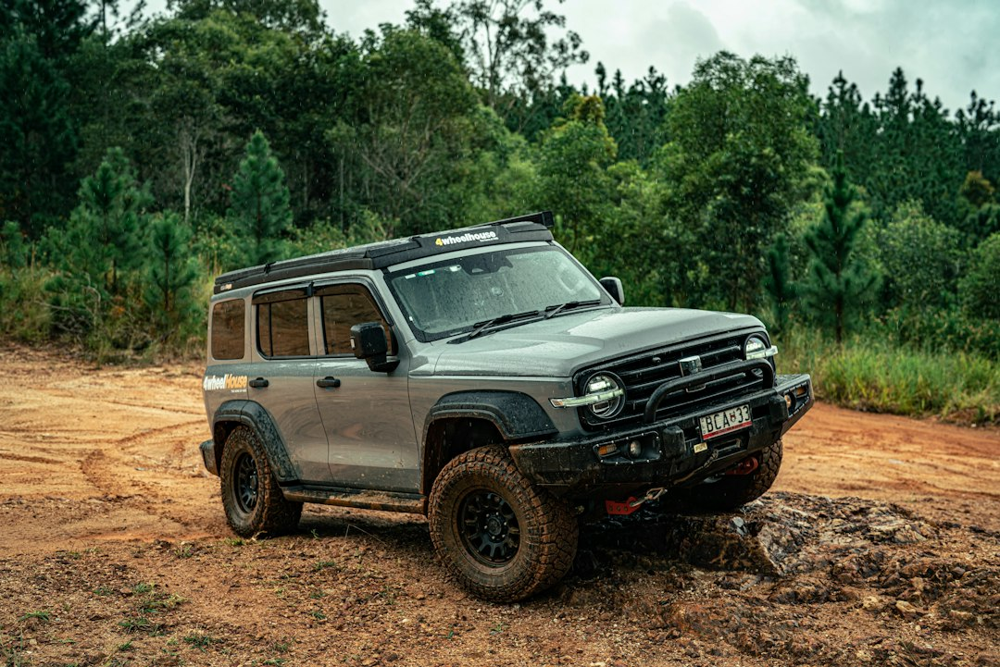

*This post contains affiliate links. As an Amazon Associate, I earn from qualifying purchases at no extra cost to you.*

A breakdown 40 miles from pavement is rarely caused by something exotic. Most remote failures trace back to a short list: a weak battery, a flat or underinflated tire, an overheating engine, a fuel or air restriction, or a connection that vibrated loose on washboard. The gap between a 20-minute fix and a four-figure recovery bill is usually process, not mechanical genius.

This guide takes a firm position: budget overlanders should spend on diagnosis and basic self-reliance before cosmetic upgrades. A scan tool, a dependable way to move air, a recovery plan, and a repeatable routine will solve more trail problems than another set of lights. Manufacturer documentation and safety guidance point the same direction. Catch problems early, fix only what you can fix safely, and know the point where you stop and call for help.

Below you will find a pre-trip baseline routine, the most common failure categories, a symptom table, a step-by-step breakdown routine, and the mistakes that most often make small problems worse. Every recommendation is filtered through cost, because a build that fits your budget is a build you will actually use.

Photo by <a href="https://unsplash.com/@4wheelhouse?utm_source=artlines_blog&utm_medium=referral">4wheelhouse</a> on <a href="https://unsplash.com/?utm_source=artlines_blog&utm_medium=referral">Unsplash</a>

## Diagnosing Common Overland Vehicle Problems in Remote Areas Starts at Home

The best remote diagnosis happens in your driveway. A vehicle that is healthy when you leave gives you something to compare against when it misbehaves at 7,000 feet with no signal. Spend one evening before each trip building a baseline you can check against later.

> **Safety warning:** Many trail repairs involve hot coolant, fuel vapor, battery sparks, jacks, and moving belts. Never open a hot radiator cap, never work under a vehicle supported only by a jack, keep ignition sources away from fuel and battery gases, and never run an engine in an enclosed space or beside a closed tent, because exhaust contains carbon monoxide. If a repair involves brakes, steering, fuel leaks, or airbags, stop and get professional help.

### Record a baseline before you leave

Write down or photograph these numbers: resting battery voltage after the vehicle has sat overnight, voltage with the engine running, cold tire pressures, fluid levels and colors, and any stored or pending trouble codes. A healthy 12-volt lead-acid battery typically rests around 12.6 volts when fully charged, and a working charging system commonly shows roughly 13.8 to 14.7 volts at idle. Those are general ranges, so confirm them against your vehicle's service manual. Save the photos in a folder that opens offline.

This is where a scan tool earns its place. The [INNOVA 3160RS OBD2 Scanner](https://www.amazon.com/dp/B084SVSFZY?tag=budgetoverlander-20) is listed as covering engine, ABS, SRS, and transmission diagnostics along with battery and alternator testing, which makes it a practical single purchase for the code-reading and electrical side of your baseline. Check the listing against your vehicle's make and model year before buying, because OBD2 engine coverage is standard on US light vehicles from 1996 onward but ABS and SRS access varies by manufacturer. Scan before you leave, save the results, and do not clear codes you do not understand.

### Think in systems, not symptoms

Nearly every mechanical complaint belongs to one of five systems: fuel, air, ignition or compression, electrical, and cooling. When the engine cranks but will not start, the useful question is which system failed, not what is wrong with the truck. Working through the systems in order prevents the classic mistake of replacing a part because a forum thread said so. A practical approach is to check the cheapest and fastest items first: fuses, connections, fluid levels, filters, and visible damage. Those checks resolve a surprising share of trail problems and cost nothing but a few minutes.

## Electrical and Starting Problems on the Trail

Electrical faults are the most common reason an overland vehicle stops moving, and budget builds are especially exposed. Fridges, lights, radios, and chargers all draw from a battery that was never designed for that load. Add dust, vibration, and temperature swings, and loose terminals become routine.

### Read the symptom before you grab tools

A rapid clicking sound with no crank usually points to a low battery or a poor terminal connection. A slow, labored crank suggests a weak battery or cold-soaked engine. A single loud click with full lights often means a starter or solenoid problem. If the engine cranks strongly but will not fire, the problem has likely moved out of the electrical system and into fuel, air, or a sensor.

Start with the terminals. Look for white or green corrosion, wiggle each clamp by hand, and check the ground strap where it meets the body and engine. Tighten with the correct wrench. With a multimeter or a scanner's battery test function, compare your reading with the baseline you recorded. A resting voltage near 12.0 volts or lower suggests a heavily discharged battery, while a running voltage that stays near the resting figure suggests the alternator or its drive belt is not doing its job.

### Isolate accessory loads

If you run a fridge or auxiliary gear off the starting battery, disconnect it before diagnosing. Parasitic draw from accessories is a common cause of mysterious dead batteries after a night in camp. A properly isolated second battery prevents the problem entirely, and a [DIY dual battery setup under $300](/2026/09/12/diy-dual-battery-setup-for-overlanders-under-300-dollars/) is one of the best value upgrades for budget builds. Until you have one, carry a lithium jump pack or quality jumper cables, and park with the vehicle positioned so a second vehicle can reach it.

Manage your spares too. Carry an assortment of automotive fuses that match your fuse box, a few feet of wire with crimp connectors, and electrical tape. A blown fuse that you can replace in two minutes should never end a trip. Remember that a fuse blowing repeatedly means a short or overload, so find the cause instead of fitting a larger fuse.

## Tire, Air, and Wheel Problems in Remote Areas

Tires cause more trailside stops than most owners expect. Sharp rock, thorns, sidewall flex at low pressure, and bead leaks all show up quickly on rough tracks. The [NHTSA tire safety guidance](https://www.nhtsa.gov/vehicle-safety/tires) is a useful baseline for pressure, inspection, and load basics, and it reinforces a simple rule: most tire failures start with ignored underinflation or damage.

### Carry your own air supply

A compressor is the single most valuable tire tool you can own, because every other repair depends on it. Plugging a puncture is pointless if you cannot reinflate afterward, and airing back up after a sandy or rocky section is faster and safer with a dependable pump. The [ARB CKMP12 Portable Air Compressor](https://www.amazon.com/dp/B004P9A35E?tag=budgetoverlander-20) is a 12-volt, high-performance, high-output option. If you run 31 to 33 inch tires and want to compare cheaper options, read our breakdown of [the best air compressors under $100](/2026/08/06/best-air-compressors-under-100-for-31-33-inch-tires/) before you decide. Whichever model you choose, check the manufacturer's stated duty cycle and connect directly to the battery with the engine running to avoid voltage sag.

### Fix what you can, respect what you cannot

Punctures in the tread area can often be repaired with a plug kit, a reamer, and your compressor. A leaking bead may be solved by cleaning the rim edge and reseating the tire with a burst of air. A damaged valve stem can be replaced with a valve core tool if you carry spares. Sidewall cuts, bulges, and tears are different. A plug in a sidewall is not a safe repair, and driving on a bulging sidewall is a blowout risk. Mount your full-size spare instead.

Check your spare's pressure before every trip, and confirm that your jack, lug wrench, and wheel-lock key actually fit. If your tire choice is part of the problem, our guides to [budget tire brands and sizes for overlanding](/2026/10/01/best-budget-tire-brands-and-sizes-for-overlanding-different-terrains-and-conditi/) cover options that balance puncture resistance and cost. Finally, follow [Tread Lightly](https://www.treadlightly.org/) principles when you stop to repair: pull off on durable surfaces, pack out used materials, and avoid widening the track.

## Overheating, Fuel, and Drivetrain Problems Away From Help

Heat, bad fuel, and drivetrain damage are the problems that feel most intimidating, but each follows a pattern you can learn.

### Overheating

When the temperature gauge climbs, pull over safely, shut off the engine if the gauge is in the red, and let the system cool before opening anything. Do not remove a radiator cap from a hot system. Once cool, check coolant level, look for leaks at hoses and the radiator, verify the belt is intact, and confirm the cooling fan runs. Low coolant plus a visible leak suggests a limp-out repair with a hose clamp or tape and a top-off from your water supply. Repeated overheating after a top-off suggests a deeper issue such as a failed water pump or head gasket, and that is a stop-and-call scenario.

### Fuel and air restrictions

Hesitation, power loss at altitude, and rough running after a fuel stop often point to contaminated fuel, a clogged filter, or a dirty air filter. Dust is the usual air-side culprit, and our guide on [protecting your engine from dust and debris](/2026/09/26/protecting-your-engine-from-dust-and-debris-on-remote-trails/) explains how to reduce that risk. If you can safely access your air filter, tap it clean, inspect it, and reinstall it before assuming something worse. Carry a spare filter if your vehicle is common enough that parts are inexpensive.

### Drivetrain, suspension, and recovery

New noises deserve immediate attention. A clunk on rough ground might be a loose skid plate bolt, while a grinding or humming noise that changes with speed can signal a wheel bearing or CV joint. Check lug nut torque, look for fluid leaks, and grab each wheel at the top and bottom to feel for play. Any play with grinding means you stop driving.

Getting stuck is a problem category of its own. Your recovery plan should be part of your vehicle setup, not an afterthought. If you decide a winch fits your plan, the [WARN 11310 Fixed Winch Mount](https://www.amazon.com/dp/B000BQRRKO?tag=budgetoverlander-20) is listed for M8274-50 winches. That makes it a mounting component, not a winch, so confirm your winch model and your vehicle or bumper mounting pattern before ordering. For many budget builds, a recovery board and strap setup is enough, and our comparison of [recovery boards, winches, and come-alongs](/2026/09/20/recovery-boards-vs-winch-vs-come-along-what-budget-travelers-actually-need/) helps you decide.

## A Decision Framework for Remote Area Overland Vehicle Problems

When something goes wrong, you want a fast way to sort problems by likelihood and risk. The table below pairs common symptoms with a first check, a probable cause, and a clear point at which to stop.

### Symptom-to-action table

| Symptom | First check | Likely cause | Trail fix | Stop and call for help if |
|---|---|---|---|---|
| Rapid clicking, no crank | Battery terminals and voltage | Weak battery or loose terminal | Clean, tighten, jump start | Voltage is normal but the starter will not turn |
| Cranks but will not start | Fuel level, codes, fuses | Fuel delivery, sensor, or relay fault | Scan codes, check fuses and relays | Codes point to a crank sensor or part you cannot replace |
| Temperature gauge climbing | Coolant (cold), belt, fan | Leak, broken belt, failed fan | Cool down, top off, replace belt or clamp hose | Heavy leak or overheating returns quickly |
| Tire losing air | Valve stem, tread, bead | Puncture or bead leak | Plug, reseat bead, reinflate | Sidewall damage or bulge |
| Dim lights, battery warning | Belt condition, running voltage | Alternator or belt failure | Shed loads, replace belt | Running voltage falls below resting voltage |
| Grinding or clunking | Visual inspection, wheel play | Bearing, CV joint, loose hardware | Retorque bolts, inspect fluid | Any wheel play or grinding under load |

Use the table as a starting point, not a verdict. Always cross-check with your service manual, and remember that a symptom can have multiple causes.

### A seven-step breakdown routine

When a problem hits, follow the same sequence every time. A routine keeps you calm and prevents you from making unforced errors.

1. **Stop in a safe, level spot.** Turn on hazards, set the parking brake, chock a wheel if you are on a slope, and shut off the engine unless a running engine is required for a test.
2. **Write down what happened.** Note the sound, smell, warning light, and what you were doing just before the failure. These details often identify the system faster than any tool.
3. **Look and smell before you touch.** Check for leaks, loose wires, broken belts, steam, burnt smell, and fuel odor. Let hot components cool.
4. **Check the basics by system.** Walk through fuel, air, electrical, ignition, and cooling in that order, starting with the cheapest and fastest checks.
5. **Scan codes and measure voltage.** Use your scan tool for stored and pending codes, and record battery and charging readings so you can compare them with your baseline.
6. **Change one variable at a time.** Replace or adjust a single item, then retest. If you change three things at once, you will not know which one mattered.
7. **Decide: fix, limp, or call.** If the repair is within your skill and tools, finish it. If you can limp out safely at low speed, do so. If neither applies, use your communication plan. A [trail radio setup for solo overlanders](/2026/08/02/best-trail-communication-radios-solo-overlanders-compared/) can make this step much easier.

## Common Mistakes That Turn Overland Vehicle Problems Into Emergencies

Most remote disasters are not caused by the original failure. They are caused by what happens next. These are the mistakes that most often turn a manageable problem into a costly one.

**Ignoring early warnings.** A faint squeal, a slow crank, a slightly soft tire, or a temperature gauge sitting higher than usual are all invitations to investigate. On the trail, small signals get bigger quickly, so check them at the next safe stop instead of hoping they disappear.

**Clearing codes without reading them.** Wiping a code with a scanner can erase information you need and may hide a developing fault. Read, record, and photograph codes before any reset. Treat each code as a lead that points to a system, not a guaranteed part number.

**Throwing parts at the problem.** Replacing a battery, sensor, or filter without testing wastes money and time, and spares are limited out there. Confirm the fault with a measurement, a visual check, or a swap with a known good part before you commit.

**Skipping safety basics.** Opening hot radiators, working under a jacked vehicle, and wiring in the dark all cause injuries that end trips. Take the extra minute to chock, cool, and light the work area.

**Driving on a compromised part.** A bulging tire, a wheel with play, or a spongy brake pedal does not improve with distance. Driving farther may turn a tow into a rollover or a collision.

**Carrying tools you cannot use.** A shelf of unfamiliar tools is not a repair kit. Practice plugging a tire, jump starting, and replacing a fuse at home so the first time is not in a canyon at dusk.

**Skipping the check-in plan.** Telling someone your route and expected return time costs nothing and can reduce rescue time dramatically. It also helps you make better decisions, because you know help is coming if needed.

## Frequently Asked Questions

### Do I really need an OBD2 scanner for overlanding?

For most budget builds, yes. A scanner turns a vague warning light into a code you can look up, and it lets you confirm whether a fault is stored, pending, or cleared. Models like the INNOVA 3160RS also advertise battery and alternator testing, which covers the two most common electrical complaints on the trail. A scanner will not fix anything, and codes point toward a system rather than a guaranteed part, so treat each code as a lead. The main tradeoff is that you need basic reading skills and a downloaded reference, because cell service is unreliable where you most need it. Save a PDF of your vehicle's service manual and common codes before you leave.

### What tools and spares should I carry first on a tight budget?

Start with the items that solve the highest-frequency failures: a reliable air source, a tire plug kit and valve core tool, a basic socket set, jumper cables or a jump pack, zip ties, fuses, hose clamps, duct tape, a multimeter, and a fluid top-off set. A compressor like the ARB CKMP12 covers tire problems and airing up, and a scanner covers codes and electrical checks. Prioritize by what has actually failed on vehicles like yours, using owner forums and manufacturer service bulletins as a guide. Add recovery gear after you have a plan for stuck situations. Spend on the basics first, because a cheap fuse kit can end a trip-ruining problem faster than expensive gear.

### When should I stop trying to fix it and call for help?

Stop when the next step could injure you, damage the vehicle beyond the current problem, or exceed your tools. Clear examples include a fuel leak, a brake failure or soft pedal, a wheel with obvious play, repeated overheating after a coolant top-off, or suspected collision damage to suspension or steering. Driving farther on a compromised component can turn a tow into a rollover. Before you leave, decide who knows your route and when they should expect a check-in, and carry a communication method that works without cell service, such as a radio or satellite messenger. Calling early costs money, but calling late can cost far more.

### Will a budget scanner work on an older vehicle?

Any US light vehicle built for the 1996 model year or later supports OBD2 for emissions-related engine data, so a standard scanner should read engine codes. Access to ABS, SRS, and transmission data depends on the manufacturer and model year, which is why you should check the product listing's vehicle coverage before buying. Pre-1996 vehicles use older systems and need different tools or manual diagnosis, which is a good argument for carrying a multimeter and learning basic tests. Carbureted or early fuel-injected rigs rely more on fundamentals like spark, fuel, and air checks. Either way, pair the scanner with a service manual for your exact model.

### Conclusion
Remote repairs are less about heroics and more about preparation. Build a baseline before you leave, carry a small set of tools that cover electrical, tire, and code-reading problems, and follow the same seven-step routine every time something goes wrong. Recognize the limits of your skills and your kit, and decide in advance where you will stop and call for help.

Your next action is simple. This weekend, scan your vehicle, record battery and tire numbers, check your spare, and practice a tire plug in your driveway. That one hour of preparation will do more for your next trip than any accessory you can bolt on.

Bookmark this guide so you can pull up the symptom table when you need it on the road.

### Related Reading
- [How to Upgrade Your Vehicle Charging System for Auxiliary Loads and Accessories](/2026/10/08/how-to-upgrade-your-vehicle-charging-system-for-auxiliary-loads-and-accessories/)
- [Best Budget Winch Accessories and Recovery Kit Add-Ons: Essentials Compared](/2026/08/18/best-budget-winch-accessories-and-recovery-kit-add-ons-essentials-compared/)

  
<strong>About the Author</strong>

  
The Budget Overlander team researches trail-ready vehicle builds with an eye on cost and practicality. Our guides draw from forum-documented builds, manufacturer specs, and owner reviews - so you know what to expect before you buy.

