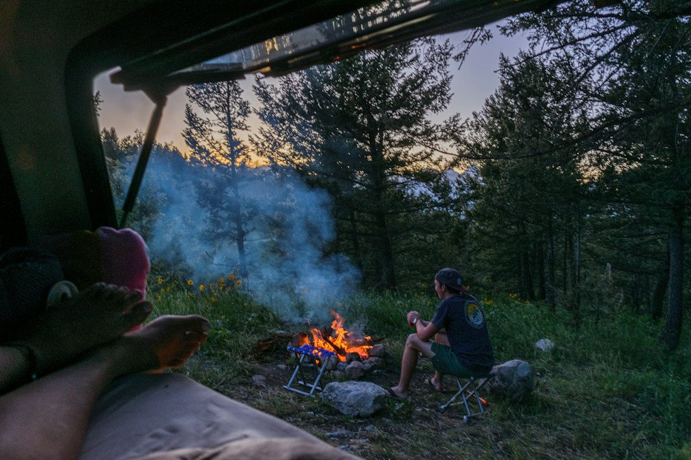

*This post contains affiliate links. As an Amazon Associate, I earn from qualifying purchases at no extra cost to you.*

Your phone is not an emergency plan. It works until the last bar of coverage disappears, which on most backcountry routes happens well before the trail gets difficult. A snapped axle, a rolled vehicle, or a medical problem 40 miles from pavement is exactly when you need to reach someone, and exactly where the cell network stops helping.

The good news is that a workable emergency communication setup does not require a four-figure budget. It requires layers. A satellite messenger handles the worst day, when nobody nearby can help. A vehicle radio handles the likely day, when your convoy needs to talk or a stranger on the trail can relay a call. A handheld ham radio fills the gap between them for the price of a tank of fuel.

My position is simple: if you travel solo, buy the satellite messenger first. If you travel in a group, buy the vehicle radio first. If you do both, you need all three layers eventually, and you can stage the purchases over a season. The rest of this guide covers what each piece does, what it costs, the legal requirements people skip, and how to set it up so it works when you are stressed.

Photo by <a href="https://unsplash.com/@mickkirch?utm_source=artlines_blog&utm_medium=referral">Mick Kirchman</a> on <a href="https://unsplash.com/?utm_source=artlines_blog&utm_medium=referral">Unsplash</a>

## Why Budget Emergency Communication Systems Need Layers

Every communication tool does one job well and the others poorly. Treating a single device as a complete solution is the most common planning error on a budget, because the tempting logic is to spend the entire allowance on one "best" product.

Think of the three jobs separately:

- **Summon help from anywhere.** This requires a satellite link, because no radio you can afford reaches a rescue coordinator from a canyon floor.
- **Talk to people nearby.** This is the convoy, the camp across the valley, or the other rig on the ridge. Radios do this cheaply and instantly, with no subscription.
- **Get information.** Weather alerts, road conditions, and repeater traffic come from a radio that can scan and listen.

A satellite messenger covers the first job, a GMRS mobile radio covers the second and part of the third, and a ham handheld covers the third and adds redundancy. Because no single product covers all three, layering beats upgrading.

There is also a cost argument. Satellite hardware is a one-time purchase plus an ongoing plan. Radios are a one-time purchase plus a license. Splitting the budget across both gives you two independent failure paths. If a battery dies, a cable corrodes, or an antenna snaps off on a branch, you still have another way out.

Communication also pairs with navigation. Knowing your position matters as much as being able to report it, so read our comparison of [GPS navigation systems and offline mapping apps for overlanders](/2026/09/29/gps-navigation-systems-and-offline-mapping-apps-compared-for-overlanders/) alongside this guide. For a broader look at radio choices for one-person rigs, see [best trail communication radios for solo overlanders compared](/2026/08/02/best-trail-communication-radios-solo-overlanders-compared/).

## Satellite Messengers: The Last-Resort Layer

A satellite communicator is the only budget-adjacent tool that can request rescue when you are alone, out of radio range, and out of cell coverage. For that reason it sits at the top of the priority list for solo travelers.

### Garmin inReach Mini 2

The [Garmin inReach Mini 2](https://www.amazon.com/dp/B09PSKG7C3?tag=budgetoverlander-20) is a satellite communicator. Its listing describes an SOS function backed by 24/7 Garmin Response, plus two-way messaging beyond cell service and navigation features.

Here is why it earns the top slot:

- **SOS reaches a monitored center.** The 24/7 Garmin Response service gives you a way to call for help when you cannot describe your location to a local dispatcher.
- **Two-way messaging.** You can answer questions ("are you injured?", "how many people?") instead of sending a blind distress signal. You can also tell family you are delayed, which prevents false alarms.
- **Works beyond cell service.** Messaging is listed for areas without cell coverage, which is where overlanding trips often go.
- **Navigation features.** The listing also mentions navigation, which adds to its usefulness on remote routes.

The tradeoffs are real. Satellite services typically require an active plan, and Garmin's plan details and pricing change, so check the current options on [Garmin's satellite communicator pages](https://www.garmin.com/en-US/c/outdoor-recreation/satellite-communicators/) before you buy. If you only travel seasonally, look for plan types that keep costs down, and confirm the current terms and any activation fees. Battery life varies with use and conditions, so check Garmin's specifications and carry a backup power source.

Placement matters. Satellite devices need a clear view of the sky. A dash position under a windshield with metallic coating or heavy tint can block the signal, so test it outside the vehicle before you trust it inside.

> **Safety note:** SOS is for life-threatening emergencies. Do not press it for a stuck vehicle you can solve with recovery gear. Use text messaging for non-urgent help, and review our guide to [recovery boards vs winch vs come-along](/2026/09/20/recovery-boards-vs-winch-vs-come-along-what-budget-travelers-actually-need/) so you can solve more problems yourself.

## Radios for the Convoy, the Trail, and the Local Network

Radios are where a small budget buys the most capability. They also bring legal requirements that many first-time buyers ignore, so treat licensing as part of the purchase price.

### GMRS Mobile Radio: Midland MXT275

The [Midland MXT275](https://www.amazon.com/dp/B07FN2FBML?tag=budgetoverlander-20) is a 15-watt MicroMobile GMRS two-way radio. Midland lists 15 high-power channels, 8 repeater channels, NOAA weather scan and alert, and 142 privacy codes. It also has an integrated control microphone.

For overlanding, GMRS has three practical advantages:

- **Real power with a real antenna.** A vehicle-mounted antenna outperforms a handheld's stubby antenna by a wide margin. Range varies hugely with terrain, but a roof or fender antenna typically gives you reliable convoy contact in rolling country and much shorter range in canyons or heavy timber.
- **Repeater access.** GMRS repeaters can extend your range across a valley or a mountain range when one is available. Check your route in advance, because repeater availability is patchy in remote areas.
- **Group simplicity.** Everyone on the same channel hears everyone else. Nobody needs an account, a subscription, or a phone signal.

On licensing, the FCC requires a GMRS license for most users, and one license generally covers the licensee's immediate family. Review the rules and current fee status on the [FCC's GMRS page](https://www.fcc.gov/general-mobile-radio-service-gmrs) before transmitting. Privacy codes do not make a conversation private. They only filter what you hear, so never say anything on the radio you would not say in public.

One practical note: confirm whether your specific listing includes an antenna and mounting hardware. If it does not, budget for a quality mobile antenna and a mount, because a poor antenna wastes the radio's power. This is where a modest extra spend improves range more than any radio upgrade.

### Ham Handheld: Baofeng UV-5R

The [Baofeng UV-5R](https://www.amazon.com/dp/B074XPB313?tag=budgetoverlander-20) is a dual-band amateur radio handheld. It is listed for the 144-148MHz and 420-450MHz bands and comes with a 1800mAh Li-ion battery. The listing describes it as suited to hiking, camping, and emergency backup use, which makes it a common choice for a backup radio that lives in a go-bag.

Why it belongs in a budget emergency kit:

- **Ham repeaters.** Amateur repeaters are widespread and often linked across large areas. In an emergency, a repeater can carry your call much farther than a handheld could alone.
- **Listening.** Even without transmitting, you can monitor local frequencies for road, weather, and trail information.
- **Low cost.** Replacing it after a dropped-in-the-dirt incident hurts far less than replacing a premium radio.

The limits matter, though. Transmitting on amateur frequencies requires an amateur radio license, and in the United States the entry-level Technician exam is the usual starting point. The [ARRL's licensing resources](https://www.arrl.org/getting-licensed) explain the process and exam prep. The UV-5R is not an appropriate radio for GMRS or FRS transmitting, so do not use it on those channels. Handheld radios like this are also fiddly to configure, so plan to program it before the trip rather than punching in frequencies at a trailhead.

Treat it as a supplement. The ham handheld shines as a backup listener and a repeater tool, while the GMRS mobile does the daily convoy work.

### Power, Antennas, and Mounting

A radio is only as reliable as the power and antenna behind it. Power the MXT275 from a properly fused source, with the fuse close to the battery or distribution point. If you are not comfortable with vehicle wiring, a professional install is cheaper than a melted harness. If you are already planning auxiliary loads, our guides on a [DIY dual battery setup under 300 dollars](/2026/09/12/diy-dual-battery-setup-for-overlanders-under-300-dollars/) and [solar power for vehicles](/2026/09/22/solar-power-for-vehicles-basics-and-budget-charging-solutions/) cover circuits that can support radios without draining your starting battery.

Antenna placement is the single biggest performance variable. Mount it high and centered on the roof if you can, away from roof rack bars and rooftop tent hardware that distort the signal. Keep people away from the antenna while you transmit at higher power, and never key up with the antenna disconnected, because that can damage the radio.

## Choosing Budget Emergency Communication Systems by Cost Tier

Here is how the three products combine into practical setups. Pick the tier that matches how you travel, then add layers as the budget allows.

| Tier | Gear | What it covers | Main limit | Ongoing cost |
|---|---|---|---|---|
| Convoy basics | GMRS mobile radio (Midland MXT275) plus a suitable antenna | Vehicle-to-vehicle, weather alerts, repeaters where available | No help beyond radio range | GMRS license |
| Solo minimum | Satellite communicator (Garmin inReach Mini 2) | SOS, two-way messaging beyond cell service | Needs sky view and a plan | Service plan |
| Budget backup | Ham handheld (Baofeng UV-5R) | Repeater access, listening, spare radio | Needs ham license | Exam and license steps |
| Layered kit | All three | Rescue, convoy, listening, redundancy | Highest upfront cost | Service plan plus licenses |

Use this decision framework:

1. **Do you often travel alone?** Start with the satellite messenger. Radios only help if someone is within range to hear you.
2. **Do you travel in a group of two or more vehicles?** Start with the GMRS mobile and get everyone on the same channel. Group coordination prevents many emergencies in the first place.
3. **Do you cross remote country with no repeaters?** Add the satellite messenger, even in a convoy, because the whole group could be stranded together.
4. **Do you want cheap redundancy?** Add the ham handheld and earn the license.

The main tradeoff is recurring cost versus capability. The satellite plan is an ongoing expense, but it is the only layer that works with zero infrastructure and zero nearby people. Radios have no monthly bill, but their range depends on terrain and other people. Pay for the layer that covers your actual risk.

## How to Set Up and Test Your Emergency Communication System

Equipment fails mostly because of setup, not hardware. Work through this sequence at home, then confirm it on an easy local trip.

1. **Handle licensing first.** Check FCC requirements for GMRS and study for the amateur exam if you plan to transmit on ham bands. Do not transmit until you are licensed for that service.
2. **Activate and test the satellite device.** Create the account, choose a plan, add emergency contacts, and send a test message outdoors. Confirm your contacts receive it and know what an incoming SOS notification means.
3. **Install the vehicle radio.** Mount the antenna, route the coax without sharp bends, and wire the radio to a fused 12V source. Keep wiring neat so vibration does not wear through insulation.
4. **Program and label the handheld.** Load your local repeaters, your GMRS-adjacent plans where applicable, and weather channels using programming software. Write the key frequencies on a card and keep it in the glovebox.
5. **Run a range check.** With a second vehicle or friend, test the radios at increasing distance and in different terrain. Note where signals drop so you know the real limits.
6. **Agree on a plan.** Set a default channel, a check-in schedule, and a call-for-help procedure with your group. Share your route and return time with someone at home.
7. **Prepare power.** Charge everything the night before and pack a spare battery or power bank. Store devices where you can reach them if the vehicle is on its side or the cabin is blocked.

## Common Mistakes and Problems to Avoid

Most emergency communication problems come from a short list of avoidable errors. Check this list before every trip.

**Buying one device and calling it done.** A satellite messenger cannot talk to the vehicle behind you, and a radio cannot reach a rescue center. Plan for both jobs, even if you phase the purchases.

**Skipping the license.** Using a ham radio without an amateur license, or using a non-certified handheld on GMRS or FRS channels, creates legal exposure and can interfere with other users. Licensing is part of the cost, so include it in your budget from day one.

**Poor antenna choice and placement.** A cheap or badly placed antenna wastes a good radio. Mount it high, keep the cable intact, and avoid blocking it with rack hardware.

**Ignoring power.** A dead battery is the most common failure. Keep devices charged, carry spare power, and fuse your wiring properly.

**Never testing.** A first-time user at a roadside breakdown makes mistakes. Test messages, radio checks, and menu navigation at home so the steps feel automatic.

**Believing privacy codes protect you.** They only filter what you hear. Anyone on the channel can still listen.

**Forgetting the human plan.** Technology helps only if someone knows to expect you. Share your itinerary, check-in times, and what to do if you miss one.

## Frequently Asked Questions

### Do I need a license to use these radios?

Yes, in most cases. GMRS radios like the Midland MXT275 generally require an FCC GMRS license, and one license typically covers the licensee's immediate family. The Baofeng UV-5R transmits on amateur bands, which require an amateur radio license, with the Technician exam as the usual entry point. Rules and fees change, so check the FCC and ARRL pages before you transmit. Receiving and listening do not require a license, but transmitting without the correct one is a legal problem. Treat the license as a one-time cost that makes the whole system legitimate and more useful, because licensed ham operators also gain access to amateur repeaters.

### Is a satellite messenger worth the subscription for occasional trips?

For solo or remote travel, usually yes. A service plan is typically needed to use 24/7 Garmin Response and two-way messaging when you have no other way to call for help. If you only travel a few weekends a year, look at flexible plan options so you pay only during trip months, and confirm current terms on Garmin's site. If you always travel in a convoy near populated routes, a radio setup may cover your risk, but a stranded group still has no way out beyond radio range. Weigh the plan cost against the cost and danger of a rescue you cannot call for.

### How far will a 15-watt GMRS mobile radio reach?

It depends mostly on terrain and antenna, not just wattage. In open or rolling country with a good roof-mounted antenna, you can often expect reliable vehicle-to-vehicle contact over a few miles. In canyons, dense forest, or behind ridgelines, range drops sharply. Repeaters can extend that reach considerably when one covers your route, but availability is uneven in remote areas. Do a range check with your convoy before relying on any number, and treat marketing range claims as best-case figures. If you will be separated by long distances, add a satellite messenger rather than assuming the radio will bridge the gap.

### Can the Baofeng UV-5R replace a mobile radio?

Not well. A handheld radio generally has less range than a vehicle-mounted radio, and the UV-5R is also only appropriate for amateur band use with a license. It works best as a low-cost backup, a repeater tool, and a listening receiver in a go-bag. The GMRS mobile is the better convoy tool. Think of the two as complementary: the mobile radio handles everyday group communication, and the handheld offers redundancy and access to ham repeaters.

### Conclusion
A solid emergency communication setup on a budget comes down to matching each tool to a specific job. The satellite messenger handles rescue, the GMRS mobile handles the convoy, and the ham handheld adds cheap redundancy. Pay for the layer that covers your biggest risk first, finish the licensing, and test everything before you leave pavement.

Your next step is practical: decide whether you travel solo or in a group, order the matching first layer, and schedule a weekend to install, program, and range-test it. Do that before the next trip, not during it.

If this guide helped, bookmark it for your pre-trip checklist and leave a comment with the setup you are planning.

### Related Reading
- [Best Trail Communication Radios Solo Overlanders Compared](/2026/08/02/best-trail-communication-radios-solo-overlanders-compared/)
- [GPS Navigation Systems and Offline Mapping Apps Compared for Overlanders](/2026/09/29/gps-navigation-systems-and-offline-mapping-apps-compared-for-overlanders/)

  
<strong>About the Author</strong>

  
The Budget Overlander team researches trail-ready vehicle builds with an eye on cost and practicality. Our guides draw from forum-documented builds, manufacturer specs, and owner reviews - so you know what to expect before you buy.

